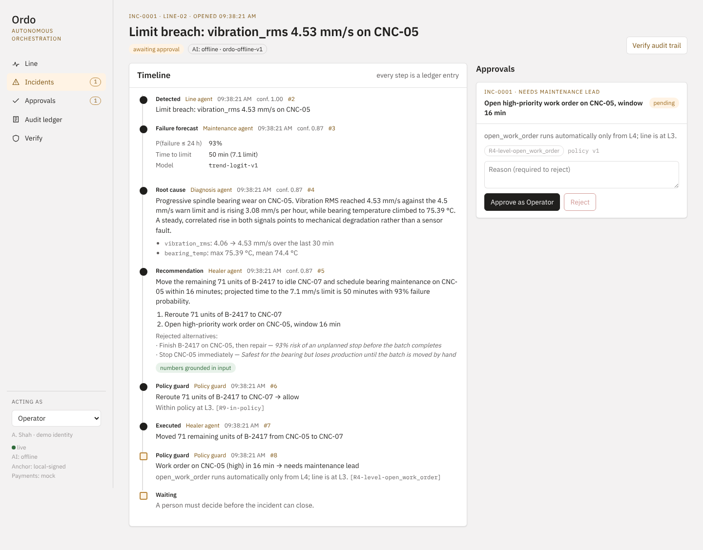
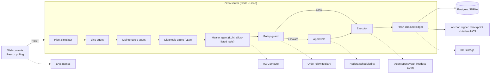

# Ordo — self-healing manufacturing, with proof

Ordo watches a production line, predicts a machine failure before it happens, explains the cause, proposes a fix, and lets a **policy guard** decide whether the fix runs on its own or needs a person. Every step is written to a **hash-chained audit ledger** that is anchored outside Ordo's database, so anyone can verify later that the record was not changed.



## The demo loop (about 60 seconds)

1. **Run demo incident** starts a bearing-wear scenario on CNC-05 (simulated telemetry, deterministic seed).
2. The **Line agent** detects vibration crossing the 4.5 mm/s warning limit.
3. The **Maintenance agent** fits a trend and forecasts the failure: about 50 minutes to the 7.1 mm/s limit, 93% probability within 24 h.
4. The **Diagnosis agent** (Gemini, or a grounded offline model) explains the root cause, citing only numbers it was given.
5. The **Healer agent** proposes allow-listed actions: reroute the batch's remaining units to idle CNC-07 and open a maintenance work order.
6. The **policy guard** (versioned YAML, L1–L4 autonomy) allows the reroute at L3 and escalates the work order to the maintenance lead.
7. The maintenance lead approves. The work order executes and the agent pays the vendor (mock, or on-chain through `AgentSpendVault`).
8. The incident closes with **downtime avoided** computed from its inputs, an evidence bundle, a summary, and a **ledger anchor**.
9. **Verify** re-walks the chain from genesis. **Simulate tampering** on any entry turns the check red.

If nobody acts, the bearing fails about 70 plant minutes in. The simulator models that too.

## Quick start

```bash
pnpm install
pnpm build                                   # web console + server
cd server && SIM_AUTOSTART=true node dist/index.js
# open http://localhost:8080 and click "Run demo incident"
```

Development with hot reload: `pnpm dev`, then open http://localhost:5173. Check configuration and every live service with `pnpm env:doctor`. No database or API keys are needed: Ordo uses embedded Postgres (PGlite) and offline agents by default. Set `LLM_PROVIDER=gemini` and `GEMINI_API_KEY` for live AI. All settings are in [`server/.env.example`](server/.env.example).

## Tests

| Command | What it covers |
| --- | --- |
| `pnpm --filter @ordo/server test` | 73 tests: simulator determinism, detector, forecast, the full policy matrix (every action × every autonomy level), ledger tamper and concurrency, LLM fallback and grounding, the whole incident loop through the HTTP API, and serverless behaviour (two instances on one database, leases, replay, pause/resume, passcode) |
| `pnpm --filter @ordo/contracts test` | 8 tests on an in-process EVM: roles, vendor allow-list, per-payment and daily caps, escrow/release/refund, pause, reentrancy, policy versioning |
| `pnpm e2e` | Playwright drives the real console through the demo: approve as the maintenance lead, verify ✔, tamper ✘ |
| `E2E_TARGET=vercel pnpm e2e` | The same demo against the Vercel build output on real Postgres, with no background timer |

## Architecture



Dotted lines are optional partner rails, switched on by environment variables. Each sits behind an interface with a local implementation, so the app always runs.

| Rail | Local (default) | Partner |
| --- | --- | --- |
| Ledger anchor | Ed25519-signed checkpoint | Hedera Consensus Service topic, verified via the mirror node |
| Approvals | In-app, role-checked | Hedera scheduled transaction that only the required role's key can release |
| Agent payments | Mock | `AgentSpendVault` on Hedera EVM: allow-listed vendors, per-payment and daily caps, escrow, kill switch |
| Policy provenance | Hash recorded with every decision | `OrdoPolicyRegistry` on Hedera; the Verify page checks the match |
| AI inference | Gemini or offline | 0G Compute (OpenAI-compatible endpoint) |
| Evidence | Local content-addressed files | 0G Storage (Merkle root as id) |
| Identity | Plain ids | ENS subnames with text records (`cnc-05.<parent>.eth`) |

The partner adapters, contracts and setup scripts are complete and typechecked. The contracts are tested on an in-process EVM. Live testnet runs need network access that CI does not have: follow [`contracts/README.md`](contracts/README.md), then run `pnpm --filter @ordo/server smoke:hedera`.

## Repository layout

```
server/      API, agents, policy guard, ledger, simulator, partner adapters (TypeScript)
web/         console (React + Vite)
contracts/   AgentSpendVault, OrdoPolicyRegistry, Hedera / ENS setup scripts
policies/    versioned autonomy policy files
e2e/         Playwright demo test
docs/        product, architecture, technical requirements, deployment, ETHGlobal plans
mockups/     original design mockups (PNG) · *.dc.html: original clickable prototype
```

## Deploy

**Vercel (primary).** One Vercel project serves the console and the API. `vercel.json` runs `pnpm vercel-build`, which writes `.vercel/output`: the static console plus one Node function for `/v1/*`. The engine is stateless: the plant is replayed from Postgres on each request, and the console polls, so it runs on serverless functions.

1. Import the repo in Vercel (root directory = repo root, framework "Other").
2. Add **Neon** from the Vercel Marketplace; it sets `DATABASE_URL` and gives every preview its own database branch.
3. Set `LEDGER_SIGNING_KEY` and `DEMO_PASSCODE` (and any partner rails), or push a file: `pnpm env:vercel push .env.production production`.
4. Push to `main` for production; every other branch gets a preview URL for live testing.

The full workflow (environments, syncing variables, `pnpm env:doctor`, rehearsing the Vercel build locally) is in [docs/environments.md](docs/environments.md).

**Docker** (Render, Railway, Fly.io, Cloud Run): the same code runs as one long-lived container with a background timer. `docker build -t ordo . && docker run -p 8080:8080 ordo`, or use the `render.yaml` blueprint.

## What is real and what is simulated

- **Real:** detection, forecasting, the LLM calls (when enabled), the policy guard, approvals, the ledger, hashing, anchoring, verification, the contracts.
- **Simulated:** the plant (three CNC cells, batches, wear), sensor data, maintenance outcomes.
- **Not included:** real PLC/OPC UA connectivity, SSO (the "acting as" switch stands in for it), ERP/MES integration.

Compliance features are designed to support 21 CFR Part 11-style records; they are not a certified system.

## Prior work

The product idea, PRD, architecture docs and UI mockups existed before the application code. See [`docs/`](docs/README.md) and the original prototype `Ordo Orchestrator.dc.html`. No application code from the prototype is reused.
