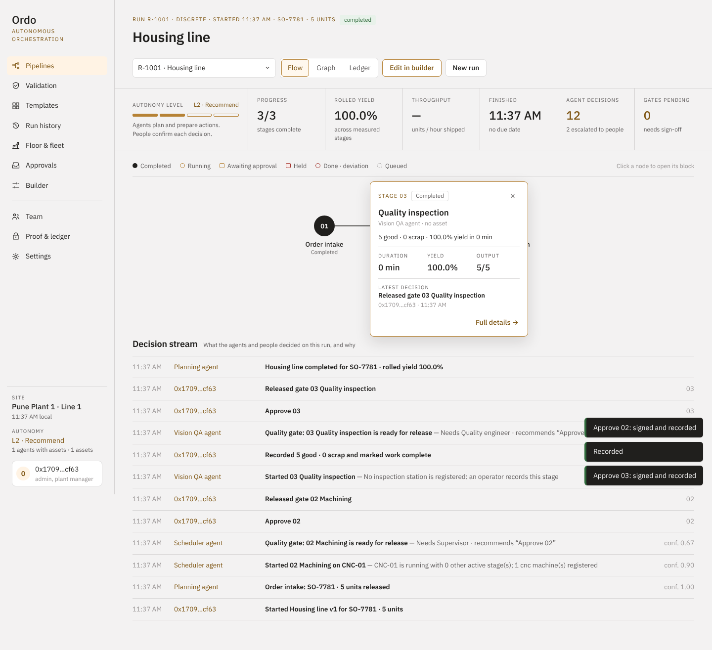
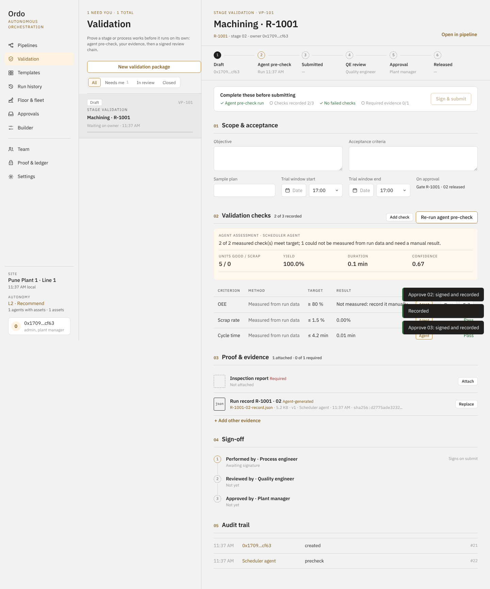
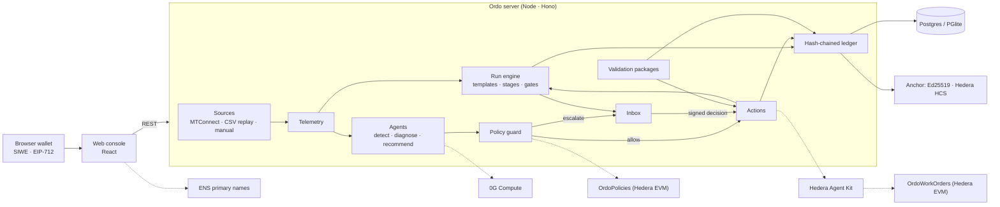

# Ordo — autonomous manufacturing orchestration, with proof

Ordo runs production pipelines across machines, robots, vehicles and people. Software agents execute each stage from live plant data, escalate what is out of policy, and record every decision with its reason and confidence. People stay in control through autonomy levels, approval gates and validation packages, and **every human decision is signed with the person's wallet**. The record is a hash-chained ledger anchored outside the database, so anyone can verify it was not changed.



## How it works

1. **Sign in with your wallet** (Sign-In with Ethereum). The first wallet creates a site and becomes its administrator; the team is added by wallet address with roles: operator, supervisor, process engineer, quality engineer, maintenance lead, plant manager.
2. **Connect real data.** Register each asset with a source: an MTConnect agent (Ordo reads `/probe` and `/current`), a CSV dataset recorded from a real machine and played back, or readings operators enter. Status, utilization and OEE are computed only from what is measured; without data the console shows "—".
3. **Pick a pipeline.** Fifteen library templates (discrete assembly, batch chemical, SMT, pharma GMP, predictive maintenance…) or your own from the **builder**, with parallel branches, merges, a rework loop, per-stage agent, resource, mode (Auto / Approve / Manual), success criteria, timeout and escalation role. Publishing creates an immutable version.
4. **Run it.** Stages are assigned to assets of the right kind. Progress comes from the machine's part counter or from what the operator records. Success criteria are evaluated on measured values; an unmeasured criterion is never assumed to pass, so a person confirms it at the gate.
5. **Agents watch the telemetry** against the limits you set. On a threshold, drift or controller fault they open an incident, diagnose it (Gemini, 0G Compute, or a grounded offline model), and recommend allow-listed actions: hold or reassign a stage, open a work order (which starts a predictive-maintenance run), raise inspection, or instruct an operator. The **policy guard** allows the action at the line's autonomy level or sends it to the inbox for the right role.
6. **The maintenance agent pays the vendor.** A work order goes to an onboarded vendor. With `OrdoWorkOrders` configured, the agent escrows the vendor's rate from the site's fund, from its own account, through **Hedera Agent Kit**: an Agent Kit policy lets it escrow only work orders Ordo opened, the contract enforces caps an admin signed and the vendor's on-chain credential, and a maintenance lead's signature releases the money. An unreleased escrow returns to the fund after 72 hours; a plant manager can stop the agent at once.
7. **People decide by signing.** Gate releases, inbox decisions, autonomy changes (raising a line's autonomy takes two plant managers) and validation sign-offs are EIP-712 typed-data signatures with single-use nonces bound to the action and entity. The server verifies them before acting and stores them with the decision.
8. **Every lot carries a passport.** Each run gets a public page, opened by its QR code without signing in. The page shows what was made, stage by stage, who signed each gate and release (by wallet address), the validators' stake and the ledger anchor that proves it. With an HTS collection configured the passport is a **Hedera NFT**: it is minted when the lot starts, its metadata follows the lot when it is held or completed, and it is airdropped to the customer when a supervisor signs the shipment.
9. **Validators have skin in the game.** People join a site by application; administrators approve by signature. Only approved validators sign reviews, approvals and quality-gate releases. With the OrdoTrust contract configured, roles are on-chain credentials, a validator must hold an active stake to sign, every release is recorded on-chain, and two other validators plus a plant manager can slash a stake into the site's quality fund.
10. **Validation packages** prove a stage or change works: agent pre-check from run data, hashed evidence files, and a three-signature chain (performed, reviewed, approved) where one person cannot sign twice.
11. **Verify** re-walks the ledger from genesis and checks each anchor (Ed25519 checkpoint, or a Hedera Consensus Service message via the mirror node).



## Quick start

```bash
pnpm install
pnpm build
cd server && node dist/index.js        # http://localhost:8080
```

Open the console with a browser wallet (MetaMask, Rabby…), sign in, and create your site. Development with hot reload: `pnpm dev`, then http://localhost:5173. No database or API keys are needed locally: embedded Postgres (PGlite) and offline agents are the defaults. To try live machine data without hardware, add an asset with the MTConnect agent `https://demo.mtconnect.org`. All settings are in [`server/.env.example`](server/.env.example); check them with `pnpm env:doctor`.

## Tests

| Command | What it covers |
| --- | --- |
| `pnpm --filter @ordo/server test` | 103 tests: migrations, SIWE sessions and EIP-712 signatures, MTConnect parsing and SSRF guard, metrics from measured data, CSV replay, pipeline graph rules and criteria, the policy matrix, the ledger, and an API flow with four wallets: site setup, invites, roles, a run advanced by part counts, a signed gate, a forged and a replayed signature rejected, an incident escalated and a signed work order, autonomy raised by two plant managers and lowered by one, a full validation chain with separation of duties, anchoring and verification; the on-chain layer against an in-process EVM: site registration, signed role grants, validator staking, an on-chain release record, a slash, the agent escrowing for a credentialed vendor, a maintenance lead's signed release, a refund after expiry, the pause, and a policy published with two plant managers; the Hedera Agent Kit tool, decoded from return-bytes mode, with its Ordo policy; and lot passports: the public page without sign-in, signed shipping, the NFT minted, updated on hold and airdropped, and the HTS transactions built offline |
| `pnpm --filter @ordo/contracts test` | 16 tests on an in-process EVM: OrdoTrust (signed role grants, replay and cross-site protection, staking and cooldown, releases only by staked validators, slashing rules), OrdoWorkOrders (admin-signed caps, credentialed vendors, per-order and daily caps, the site's fund, pause, signed release, refund, withdrawal, a re-entering vendor) and OrdoPolicies (two plant managers to raise, one to lower, increasing versions) |
| `pnpm e2e` | Playwright with an injected test wallet drives the real console: sign in, create a site, register an asset, record readings, build and publish a pipeline, run it, sign two gates, verify the ledger |
| `E2E_TARGET=vercel pnpm e2e` | The same flow against the Vercel build on real Postgres, with no background timer |

## Architecture



| Rail | Default | Partner |
| --- | --- | --- |
| Identity | Wallet sign-in (EIP-4361) | ENS primary names shown for team members |
| Decisions | EIP-712 signatures verified server-side | ERC-1271 smart wallets via `AUTH_RPC_URL` |
| Ledger anchor | Ed25519-signed checkpoint | Hedera Consensus Service topic, verified through the mirror node |
| Roles and validators | Approved in-app by signed applications | `OrdoTrust`: credentials, validator stakes, release records, slashing (Hedera EVM or any EVM chain). Live on Hedera testnet at [`0x608c…b9e1`](https://hashscan.io/testnet/contract/0x608cba52976e34fa160fe64ff0499a8a5a4eb9e1) |
| Autonomy policies | Two plant managers' signatures to raise, recorded in the ledger | `OrdoPolicies`: the same rule enforced on-chain, each change published with its signatures |
| Lot passports | Public page and QR code for every lot, in Ordo | HTS NFT per lot (`HEDERA_PASSPORT_TOKEN_ID`): minted at start, metadata updated on hold and completion (HIP-657), airdropped to the customer on a signed shipment |
| Agent payments | Work orders assign a vendor, no money moves | `OrdoWorkOrders` via Hedera Agent Kit: per-site fund, admin-signed caps, credentialed vendors, escrow released by a maintenance lead's signature, refunds, kill switch |
| Deadlines | The server's engine cycle refunds expired escrows and raises stage timeouts | Hedera Schedule Service (HIP-423): the 72h escrow refund, the validator payout at the end of the unstake cooldown and each stage's timeout are scheduled transactions the network executes on time, even if Ordo is down |
| AI inference | Offline grounded model | Gemini, or 0G Compute (OpenAI-compatible) |

## Repository layout

```
server/      API, auth, plant data sources, run engine, agents, policy guard, validation, ledger
web/         console (React + Vite) with its own Select, calendar, modal and drawer components
contracts/   OrdoTrust, OrdoWorkOrders, OrdoPolicies; Hedera / ENS setup scripts
policies/    versioned autonomy policy
e2e/         Playwright flow with an injected test wallet
docs/        product, pipeline templates, validation workflow, environments, plans
mockups/     design mockups (PNG) · *.dc.html: original clickable prototype
```

## Deploy

**Vercel (primary).** `vercel.json` runs `pnpm vercel-build`, which writes the static console plus one Node function for `/v1/*`. All state is in Postgres (Neon from the Vercel Marketplace sets `DATABASE_URL`). Each console poll runs at most one engine cycle every 4 seconds across instances, under a database lease. Set `LEDGER_SIGNING_KEY`, and `BOOTSTRAP_ADMIN_ADDRESS` if only your wallet may create sites. The full workflow is in [docs/environments.md](docs/environments.md).

**Docker**: `docker build -t ordo . && docker run -p 8080:8080 ordo`. Use this on a plant network to reach MTConnect agents with private addresses, which the cloud deployment refuses.

## On-chain proof

Settled on Hedera testnet, each paid by an agent with no one approving:

| What | Who paid | Settled transaction |
|---|---|---|
| `assess_vibration` on Ordo's metered MCP server (x402, 0.1 HBAR) | buyer agent [0.0.11118723](https://hashscan.io/testnet/account/0.0.11118723) | [0.0.9185802@1792617008.223711953](https://hashscan.io/testnet/transaction/0.0.9185802-1792617008-223711953) |
| `forecast_failure` on Ordo's metered MCP server (x402, 0.1 HBAR) | buyer agent [0.0.11118723](https://hashscan.io/testnet/account/0.0.11118723) | [0.0.9185802@1792617008.694161567](https://hashscan.io/testnet/transaction/0.0.9185802-1792617008-694161567) |

Reproduce it with the **x402 demo** workflow (Actions tab): it opens a fresh buyer account and pays `https://aiwarriors.vercel.app/v1/x402/mcp` per tool call. Every sale is also listed at `GET /v1/x402`.

## What is real

- Everything in the console comes from what you connect or record. There is no simulator and no sample data.
- Not included yet: OPC UA connectivity, ERP/MES integration, file storage outside Postgres (evidence is stored hashed in the database, up to 4 MB per file).
- Compliance features are designed to support 21 CFR Part 11-style records; Ordo is not a certified system.

## Prior work

The product idea, PRD, architecture docs and UI mockups existed before the application code. See [`docs/`](docs/README.md) and the original prototype `Ordo Orchestrator.dc.html`. No application code from the prototype is reused.
