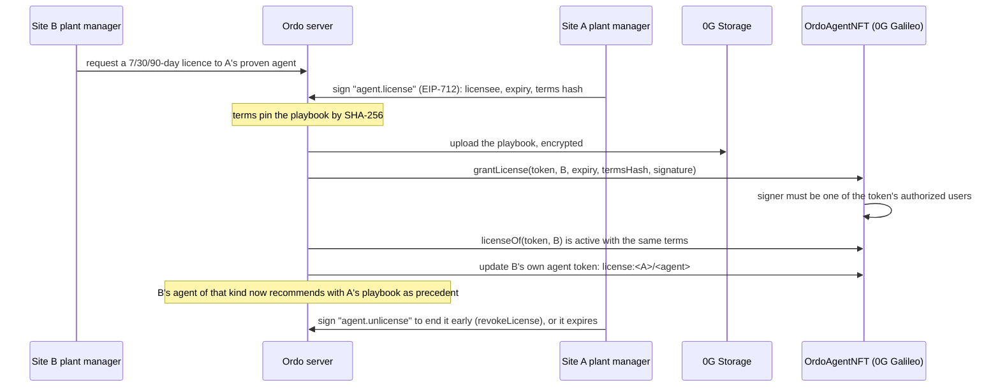

# Ordo contracts and chain setup

Three contracts on Hedera, two on Sepolia for ENS (below). Every authorisation in them is an Ordo EIP-712 signature (`OrdoSignature`, the typed data people sign in the console), so anyone can relay a transaction and the contract checks who signed, not who sent it.

| Contract | Purpose |
| --- | --- |
| `OrdoTrust` | Role credentials per site, granted with a site admin's signature; validator stakes with an unstake cooldown, after which anyone may pay the stake back to the validator (`withdrawFor`, the call Hedera's scheduler makes); release records that need a staked reviewer and a staked plant manager; slashing by two other validators plus a plant manager into the site's quality fund. |
| `OrdoWorkOrders` | The maintenance agent pays vendors within limits people set: a per-site fund, per-order and per-day caps an admin signs, escrow only to holders of the site's `VENDOR` credential, release on a supervisor's or plant manager's signature, refund after expiry, and a pause an admin or plant manager signs. |
| `OrdoPolicies` | Each line's autonomy level and policy hash. Raising autonomy or changing the policy needs two different plant managers' signatures; lowering needs one. |
| `OrdoSpecVerifier` | Generated Groth16 verifier for `circuits/spec_check.circom`: checks a lot passport's proof that a criterion was met, without the measurement. Stateless; anyone can deploy and call `verifyProof`. |
| `OrdoStageVerifier` | Generated Groth16 verifier for `circuits/stage_check.circom`: checks that the counts a stage's gateway (or operator) signed meet the stage's criteria. `OrdoLotResolver` calls it for every stage of a release. |
| `OrdoProofs` (library) | The two statements proof of work rests on: `OrdoReading` (a stage's counts as a signed commitment) and `OrdoRelease` (exactly what three people release: site, package, run, lot, content hash, proof root). See [docs/proof-of-work.md](../docs/proof-of-work.md). |

`OrdoWorkOrders` and `OrdoPolicies` read credentials from the deployed `OrdoTrust` and share its signature scheme through `OrdoSigned`.

```bash
pnpm --filter @ordo/contracts test     # compile with npm solc + 25 tests on an in-process EVM
```

## Hedera testnet

Live on Hedera testnet:

| What | Where |
| --- | --- |
| `OrdoTrust` | [`0x608cba52976e34fa160fe64ff0499a8a5a4eb9e1`](https://hashscan.io/testnet/contract/0x608cba52976e34fa160fe64ff0499a8a5a4eb9e1) |
| `OrdoWorkOrders` | [`0x600807998f50258bc0319afab3411225c51a993f`](https://hashscan.io/testnet/contract/0x600807998f50258bc0319afab3411225c51a993f) |
| `OrdoPolicies` | [`0xfcde36a4668c18c219ba1f3696bb0d68b9babd43`](https://hashscan.io/testnet/contract/0xfcde36a4668c18c219ba1f3696bb0d68b9babd43) |
| Ledger topic (HCS) | [`0.0.11087048`](https://hashscan.io/testnet/topic/0.0.11087048) |
| Lot passport collection (HTS NFT) | [`0.0.11087232`](https://hashscan.io/testnet/token/0.0.11087232) |
| Maintenance agent account | [`0.0.11087374`](https://hashscan.io/testnet/account/0.0.11087374) · EVM `0x8af16bA6Bbae3DDA39acF028017e175390584db2` |

Deployments run in GitHub Actions with the operator account held in the `hedera-testnet` environment (`HEDERA_OPERATOR_ID`, `HEDERA_OPERATOR_KEY`, an **ECDSA** key):

- **Deploy OrdoTrust** (`.github/workflows/deploy-trust.yml`): push a change to `.github/deploy/trust.request`.
- **Hedera setup** (`.github/workflows/hedera-setup.yml`): list what to create in `.github/deploy/hedera.request` and push it:
  - `topic` creates the HCS topic the ledger is anchored to (`HEDERA_TOPIC_ID`),
  - `contracts` deploys `OrdoWorkOrders` and `OrdoPolicies` against `OrdoTrust` (`TRUST_WORKORDERS_ADDRESS`, `TRUST_POLICIES_ADDRESS`),
  - `passport` creates the HTS NFT collection for lot passports (`HEDERA_PASSPORT_TOKEN_ID`); the operator is treasury, supply and metadata key,
  - `agent` creates the maintenance agent's own account with 20 HBAR (`HEDERA_AGENT_ID`); its key goes straight to Vercel and is never printed, so this one needs `VERCEL_TOKEN` as a repository secret.

The logs print only public values. The same scripts run locally:

```bash
cd contracts
export HEDERA_OPERATOR_ID=0.0.xxxx HEDERA_OPERATOR_KEY=0x<ecdsa hex>
pnpm deploy:trust
pnpm setup:hedera topic
TRUST_CONTRACT_ADDRESS=0x… pnpm setup:hedera contracts
SECRET_OUT=agent.env pnpm setup:hedera agent
cd ../server && pnpm smoke:hedera      # posts an anchor to the topic and verifies it on the mirror node
```

Then, in Ordo: register the site on-chain (Team & validators → Validators), sign the agent's caps and add funds (Work orders), and onboard vendors. When the agent's work order is approved, or it acts on its own at L4, it escrows through Hedera Agent Kit; a maintenance lead's signature pays the vendor.

Things to check on the day:

- Inside the EVM Hedera counts HBAR in tinybars (8 decimals); JSON-RPC `value` uses 18 decimals. Caps and amounts in the contracts are tinybars.
- The agent account is created with an ECDSA alias, so its EVM address (the one the caps are signed for) is derived from its key.
- Verify contract source on Sourcify for chain 296 so HashScan shows it; `artifacts/*.json` has the ABI and bytecode.

## Deadlines on Hedera's Schedule Service

Three deadlines run as Hedera scheduled transactions (`ScheduleCreateTransaction` with `waitForExpiry`, HIP-423) that the network executes at their expiration time, so they happen even if Ordo is down. The operator pays and holds the admin key, and Ordo deletes a schedule that is no longer needed (`server/src/core/schedules.ts`, `server/src/chain/hedera.ts`):

| Deadline | Scheduled transaction | Deleted when |
| --- | --- | --- |
| Work-order escrow, 72h after it opens | `OrdoWorkOrders.refund(site, workOrder)` at the on-chain `expiresAt` | a maintenance lead releases the payment |
| Validator unstake cooldown | `OrdoTrust.withdrawFor(site, validator)` at `unlockAt`, paying the stake back to the validator | the validator stakes again |
| Stage timeout | an HCS message `{kind:"stage.timeout"}` to the ledger topic at the deadline; Ordo raises the inbox item once the mirror node shows it executed | the stage finishes in time |

Ordo only does the job itself when a schedule could not be created (less than a minute or more than 62 days away, or Hedera unreachable) or has not run 5 minutes after its time. `HEDERA_SCHEDULES=off` turns it off.

`withdrawFor` is new in `OrdoTrust`, so validator payouts need it redeployed (**Deploy OrdoTrust**, then **Hedera setup** `contracts` against the new address); until then Ordo sees the function is missing and validators withdraw from their wallets as before. Refunds and timeouts work with the contracts already deployed.

## Zero-knowledge spec proofs

A lot's public passport says whether each acceptance criterion was met but never shows the measurement (yields, scrap, cycle times and OEE are trade secrets). When a stage closes, the server commits each measured value as `Poseidon(subject, value, salt)` in the hash-chained ledger (so it is anchored with everything else), and for every criterion that passed it proves with Groth16 that the committed value meets the target. The passport carries the proof and its public signals `[subject, target × 10⁴, op, commitment]`; the server, the buyer's browser (snarkjs) or `OrdoSpecVerifier` can each check it, with the key at `GET /v1/public/zk/spec-check`.

The circuit's keys live in `server/zk`. Rebuild them after changing the circuit (needs the [circom 2](https://docs.circom.io/getting-started/installation/) compiler; the trusted setup is a local single-party ceremony, fine for a demo, not for production):

```bash
cd contracts && CIRCOM=/path/to/circom node scripts/zk-setup.mjs
```

## Zero-knowledge stage proofs (proof of work)

Each stage's counts are signed where they were made and proven against the stage's criteria; a release signs the root of those proofs and `OrdoLotResolver` verifies them on-chain. The design, trust model and redeploy notes are in [docs/proof-of-work.md](../docs/proof-of-work.md). The circuit is on a public trusted setup (phase 1 from the PSE Perpetual Powers of Tau; phase 2 contributions are recorded in `server/zk/stage_check.ceremony.json`):

```bash
cd contracts && CIRCOM=/path/to/circom node scripts/zk-stage-setup.mjs setup      # compile + phase 2 + first contribution
node scripts/zk-stage-setup.mjs contribute "Your name"                              # each further contributor
node scripts/zk-stage-setup.mjs beacon <future block hash>                          # close the ceremony
node scripts/zk-stage-setup.mjs verify                                              # anyone: check the zkey
```

## Build log on HCS

Post the current commit to the HCS build topic every few hours:

```bash
cd server && HEDERA_BUILD_TOPIC_ID=<build topic> pnpm anchor:build
```

## ENS (Sepolia, ENSv2)

ENSv2 gives every name its own registry. `scripts/ens-setup.ts` registers Ordo's parent name once: it deploys Ordo's `PermissionedResolver` and a `UserRegistry` through ENS's `VerifiableFactory`, then registers `<label>.eth` (commit, wait, pay in the testnet's MockUSDC) pointing at both. Run it from the **ENS setup** workflow (put the label in `.github/deploy/ens.request`; needs the `sepolia` environment with `ENS_OWNER_KEY` holding some Sepolia ETH), or locally:

```bash
ENS_OWNER_KEY=0x... ENS_LABEL=ordo-mfg pnpm setup:ens
```

**Live:** [`ordo-mfg.eth`](https://sepolia.app.ens.domains/ordo-mfg.eth), registry `0x1F621f14718a9251b74F1683D6F1D5F8E9889358`, resolver `0xC2992b48350F642cd820a22DAf5ffaDB6e26566C`, owner `0x38e6C7622b2E9BdcB16821E88083274489625b74`.

The app then issues the rest as the site changes: `<site>.<parent>` with its own `UserRegistry`, and in it a name for each person (minted to their wallet with no roles on the token, so it cannot be transferred; revoked when they hold no role), each asset and each agent, with `com.ordo.*` text records in Ordo's resolver. The contract addresses are the Sepolia set ENS deployed on 2026-10-01 (`server/src/chain/ensv2.ts`).

### ENS as the access layer

Two more contracts on Sepolia make the names do something:

| Contract | Purpose |
| --- | --- |
| `OrdoEnsRoles` | Ordo roles read from ENS. A wallet holds a role at a site only while it owns its `member-<40 hex address>` name in the site's registry and the name's `com.ordo.roles` record lists the role (`com.ordo.validator` gives VALIDATOR). Revoke or let the name expire and the role is gone. It answers OrdoTrust's `sites`/`roles` calls (`IOrdoTrust`), so `OrdoWorkOrders` and `OrdoPolicies` can be deployed against it too. |
| `OrdoLotResolver` | The resolver of each site name, so every `lot-<order>.<site>.<parent>` resolves with no registration (ENSIP-10 wildcard). `recordRelease` stores a lot's release only with the three `OrdoRelease` statements from people whose member names carry the roles (any role, VALIDATOR, VALIDATOR + PLANT_MANAGER), and only if every stage proof it is given verifies (`OrdoStageVerifier`), was signed by a holder of the DEVICE or OPERATOR role, and folds to the proof root the three signed; `com.ordo.release*` records come from that, `com.ordo.release.proofs` included. Other records (`url`, `com.ordo.status`, `com.ordo.product`…) come from Ordo's CCIP-Read gateway (`/v1/public/ens/{sender}/{data}.json`), signed with the ENS owner key. Names that are not lots go to Ordo's resolver. |

Deploy them with the **ENS setup** workflow (`contracts https://<Ordo's public URL>` in `.github/deploy/ens.request`), or locally with `pnpm setup:ens-contracts` (see `scripts/ens-contracts.ts`). It sets `ENS_ROLES_ADDRESS` and `ENS_LOT_RESOLVER_ADDRESS`; the app then links each site in `OrdoEnsRoles`, points the site name at the lot resolver, and records each released package on its lot's name.

## 0G (Galileo testnet, chain 16602)

`src/OrdoAgentNFT.sol` makes each agent of each site an ERC-7857 iNFT: its intelligent data is the policy hash it acts under, its model, the autonomy each line gives it and its scope; Ordo updates it when any of those change (`Updated` events), and the site's plant managers are its authorized users. Agents belong to their site, so tokens do not transfer. It uses OpenZeppelin's ERC-721, which needs Cancun, so `compile.mjs` compiles it in a separate Cancun pass (0G supports Cancun) and its tests run on anvil.

**Live:** `OrdoAgentNFT` `0x9577498d6305a8498744ab33217fab6722ff8141` on 0G Galileo, minter `0xa902C5542Fc209e639Ed151a3619e103D18bD55a`.

### Licensing a proven agent to another site

Agents don't transfer, but a site can license one. An agent is **proven** once people have decided at least 3 of its recommendations and accepted at least 75% (`PROVEN` in `server/src/core/agent-licenses.ts`). Its **playbook** is the accepted cases: asset kind, signal, the actions taken and their settings, not the site's ids.



`grantLicense` and `revokeLicense` take the same `OrdoSignature` typed data as the Hedera contracts, with the domain on chain 16602, so the wallet signs for 0G Galileo. The contract rebuilds the entity (`<site>/<agent>><licensee>#<expiresAt>#<termsHash>`) and rejects a signer who isn't an authorized user of that token, whoever relays it. Only sites that list publicly (Settings → public pipelines) appear to other sites as licensors.

**After this merges, redeploy the contract:** the licence functions are new, so the live `0x9577…8141` doesn't have them. Put `inft` in `.github/deploy/zerog.request` on `main` and push; the workflow deploys the new `OrdoAgentNFT` and writes `ZG_INFT_ADDRESS` to Vercel. Don't push that file on a branch, because the workflow runs on any push that changes it. Ordo notices the new address and mints every agent again on the new contract.

The **0G setup** workflow (`.github/deploy/zerog.request`; `key` generates Ordo's 0G key and keeps it in Vercel) deploys it (`inft`), turns on evidence copies to 0G Storage (`storage`) and funds the 0G Compute ledger (`ledger`), and writes the values and the key to Vercel. Locally:

```bash
ZG_PRIVATE_KEY=0x... pnpm setup:zerog                          # deploy OrdoAgentNFT → ZG_INFT_ADDRESS
ZG_PRIVATE_KEY=0x... pnpm --filter @ordo/server zerog:ledger   # fund 0G Compute (3 0G), list providers
```
