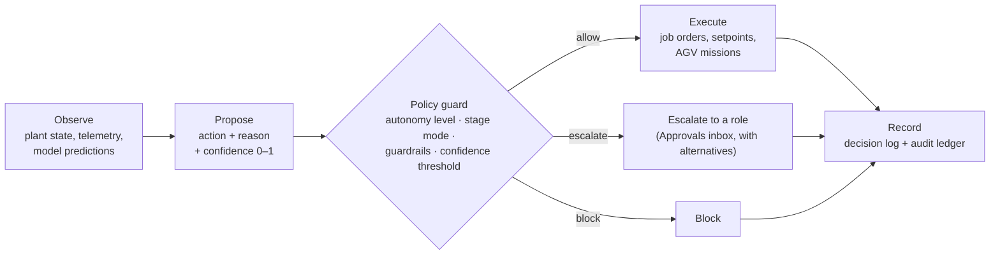

# Agent decision model

Every agent action follows the same path, so it can be explained and replayed.

1. **Observe.** The agent reads plant state, recent telemetry and model predictions for its scope.
2. **Propose.** It forms an action (for example "Split batch across CNC-04 and CNC-05"), a plain-language reason referencing the data, and a confidence between 0 and 1.
3. **Check policy.** The policy guard compares the action with the autonomy level, stage mode, guardrails (limits on setpoints, cost, quantity, safety) and the confidence threshold. Result: allow, escalate to a role, or block.
4. **Execute or escalate.** Allowed actions are dispatched. Escalated actions appear in Approvals with the alternatives the agent considered.
5. **Record.** Action, reason, confidence, policy result and outcome are written to the decision log and audit ledger.

## Example decisions by agent

| Agent | Action | Reason |
| --- | --- | --- |
| Scheduler | Split batch across CNC-04 and CNC-05 | CNC-04 spindle load forecast 94% for the next 2 h; split keeps takt under 62 s |
| Vision QA | Raised sampling rate to 100% | Cpk on bore diameter fell from 1.52 to 1.36 over the last 3 lots |
| Supply | Substituted approved alternate part | Primary lot short 400 pcs; alternate is on the approved vendor list |
| Process | Adjusted setpoint −1.5 °C | Zone 3 overshoot trend; model predicts viscosity drift otherwise |
| Maintenance | Opened predictive work order | Vibration RMS up 18% over 36 h; failure probability 0.22 in 5 days |

## Safety boundary

Agents never bypass machine safety systems. Safety PLCs are read-only to Ordo, and if the cloud link drops the edge gateway completes the current safe step and holds.

## What goes into a decision

| Field | Purpose |
| --- | --- |
| Action | What the agent wants to do, in plain language and as a machine-readable command |
| Reason | The data that justifies it, cited by value (e.g. "Cpk fell from 1.52 to 1.36 over 3 lots") |
| Confidence (0–1) | How sure the agent is. Below the site's threshold, the action is escalated whatever the autonomy level |
| Alternatives | Other options considered, with their trade-offs; shown to the person if escalated |
| Model version | Which registry model produced it, so the decision can be replayed |
| Policy result | Allow, escalate (to which role) or block, and why |
| Outcome | What actually happened after execution |

## Guardrails the policy guard applies

| Guardrail | Example |
| --- | --- |
| Setpoint limits | A Process agent may move an oven zone by at most ±2 °C from the validated profile |
| Quantity limits | Batch splits or reroutes above a set number of units need approval |
| Cost limits | Overtime or supplier substitutions above a cost delta escalate to the plant manager |
| Safety | Any action touching a safety function is blocked |
| Scope | An agent can act only on its own stage types and resources |
| Stage mode | *Approve* stages always need a person; *Manual* stages are executed by a person |

The examples are illustrative. Actual limits are set per site and stored as versioned policy. The full autonomy-by-situation matrix is in [architecture.md, section 10](architecture.md#10-autonomy-and-the-policy-guard).

## Escalation in practice

When the guard escalates, the item appears in **Approvals & exceptions** with the agent's evidence, its options (recommended one marked) and confidence. The person can approve the selected option, or reject and hold the affected stage. Either choice is recorded alongside the original proposal. Decisions that need formal proof go to a validation package instead.
