# System architecture

This document explains how Ordo is built: what each layer and service does, how data and commands move between them, how people stay in control, and what happens when things fail.

> **How to read this.** Text without a marker restates the Ordo v1.0 specification. Paragraphs marked **Design detail** go further than v1.0: they are proposed ways to build what the spec describes, written so the team can review and change them. Technology names under **Candidate technologies** are options, not decisions; see [data-sources.md](data-sources.md) for providers and pricing.

**Contents**

1. [Purpose and design principles](#1-purpose-and-design-principles)
2. [System context](#2-system-context)
3. [The five layers](#3-the-five-layers)
4. [L1 · Shop floor](#4-l1--shop-floor)
5. [L2 · Edge & connectivity](#5-l2--edge--connectivity)
6. [L3 · Data platform](#6-l3--data-platform)
7. [L4 · Orchestration core](#7-l4--orchestration-core)
8. [L5 · Experience](#8-l5--experience)
9. [End-to-end flows](#9-end-to-end-flows)
10. [Autonomy and the policy guard](#10-autonomy-and-the-policy-guard)
11. [Events and messages](#11-events-and-messages)
12. [Enterprise integration](#12-enterprise-integration)
13. [Cross-cutting concerns](#13-cross-cutting-concerns)
14. [Deployment and availability](#14-deployment-and-availability)
15. [Failure modes](#15-failure-modes)
16. [Technology mapping](#16-technology-mapping)
17. [Prototype versus target system](#17-prototype-versus-target-system)
18. [Open decisions](#18-open-decisions)

---

## 1. Purpose and design principles

Ordo coordinates production work across machines, robots, vehicles and people. A production process is a **pipeline**: a directed graph of **stages** that can branch into parallel work, merge back, and loop for rework. Software **agents** run each stage against live plant data. They plan, assign resources, adjust parameters and decide when a stage is complete. People set how much the agents may do, approve gates, and formally validate changes with evidence. Every decision and every signature is written to an append-only audit ledger.

The architecture follows from six principles:

| Principle | What it means in the design |
| --- | --- |
| **People stay in control** | Every agent action passes the policy guard, which applies the line's autonomy level (L1–L4). Gates stop a run until a person releases it. Validation packages need three ordered signatures. |
| **Every decision is explainable** | Agents must give an action, a plain-language reason that cites data, and a confidence score. Nothing executes without that record. |
| **Safety systems are never touched** | Safety PLCs are read-only to Ordo. Agents cannot bypass interlocks. The edge completes the current safe step and holds if the cloud is unreachable. |
| **The plant keeps running at the edge** | L2 runs on-premise with store-and-forward and a local agent cache, so a lost cloud link degrades Ordo instead of stopping the plant. |
| **Audit by default** | The audit ledger is hash-chained; evidence files are content-hashed and versioned. Records cannot be changed silently. |
| **No change to existing equipment** | L1 is connected through standard protocols (OPC UA, MQTT/Sparkplug B, Modbus TCP, MTConnect). Ordo adapts to the plant, not the reverse. |

---

## 2. System context

Who and what Ordo talks to, before looking inside it.

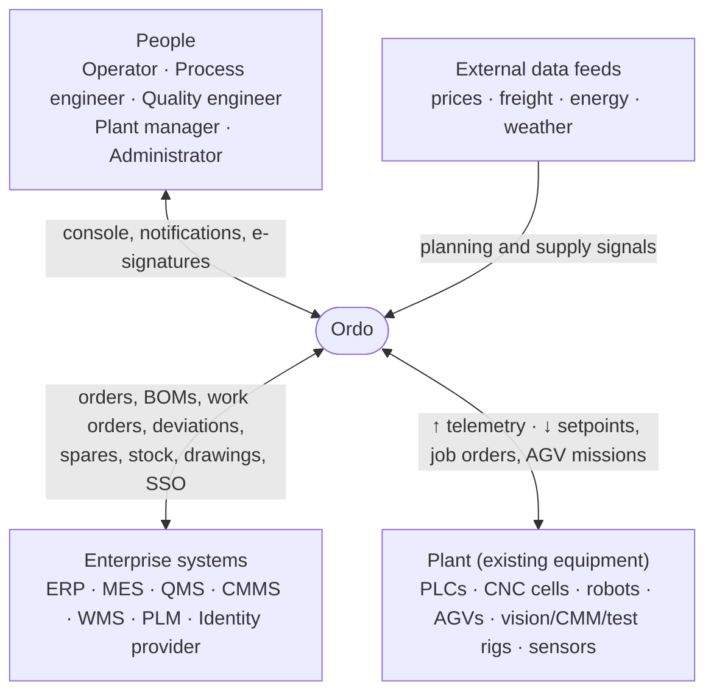

| Actor | What they do with Ordo |
| --- | --- |
| Operator | Executes manual stages, records manual checks, raises holds |
| Process engineer | Builds pipelines, prepares validation packages, attaches proof |
| Quality engineer | Reviews checks and evidence, signs quality gates, requests changes |
| Plant manager | Final approval, sets autonomy per line, handles escalations |
| Administrator | Users, roles, sites, connectors, policies |
| Plant equipment | Sends signals; receives job orders, setpoints and missions (never safety commands) |
| Enterprise systems | Exchange orders, work orders, quality records, maintenance, stock and engineering data |
| External feeds | **Design detail:** commodity, freight, energy and macro data for the Planning and Supply agents (examples in [data-sources.md](data-sources.md)) |

---

## 3. The five layers

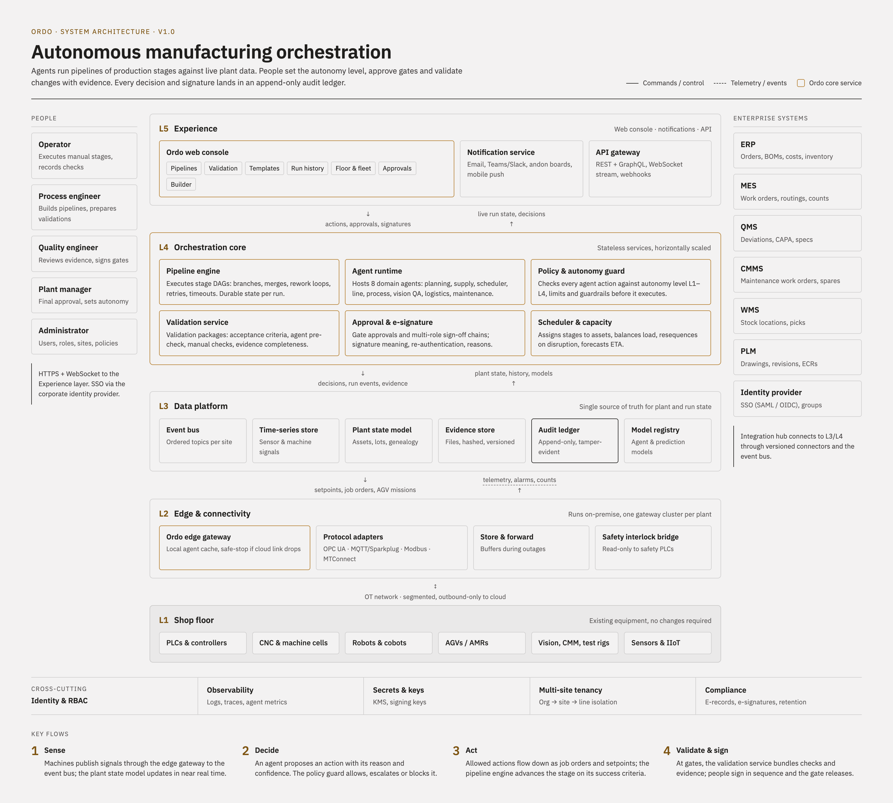

*Rendered diagram: [`Ordo Architecture.dc.html`](../Ordo%20Architecture.dc.html). Gold outlines mark Ordo core services; the audit ledger is outlined in black.*

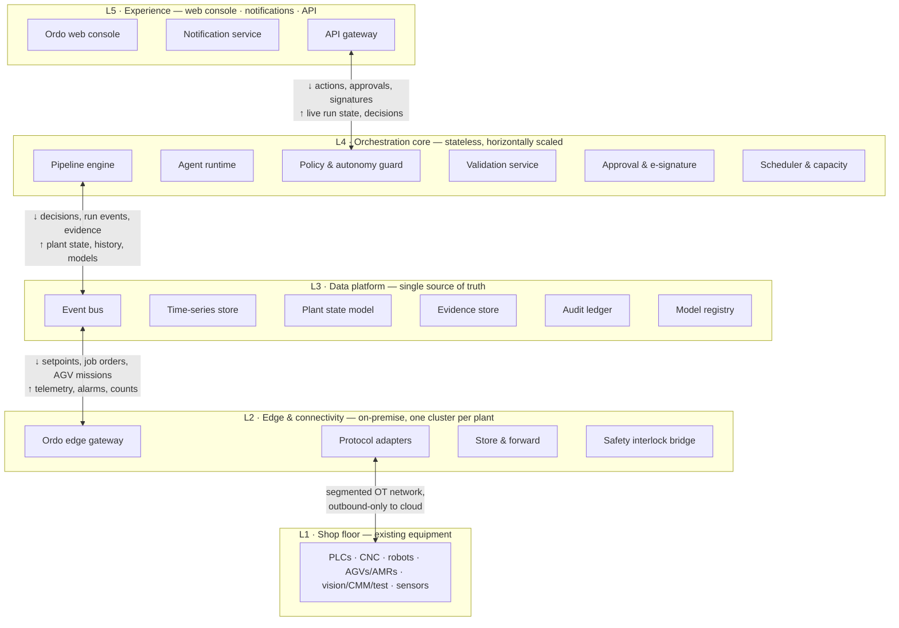

Arrows marked ↓ carry **commands and control** downward; ↑ carries **telemetry, state and events** upward.

| Layer | Runs where | Owns | Talks to |
| --- | --- | --- | --- |
| L5 Experience | Cloud / customer DC; browser | What people see and do | L4 (commands), L4/L3 (live state) |
| L4 Orchestration core | Cloud / customer DC | All decisions: pipelines, agents, policy, validation, signatures, scheduling | L5 above, L3 below, enterprise systems |
| L3 Data platform | Cloud / customer DC | All state and history | L4 above, L2 below, enterprise systems |
| L2 Edge & connectivity | On-premise, per plant | Protocol translation, buffering, local safety | L3 above, L1 below |
| L1 Shop floor | The plant | Physical work | L2 only |

**Why layered this way.** Decisions (L4) are separated from state (L3), so L4 services can be stateless and scaled or restarted freely. The edge (L2) is the only layer that touches equipment, so OT security, protocol handling and outage behaviour are concentrated in one place. People (L5) never talk to machines directly; every human action is a command to L4 that is checked, executed and recorded like an agent action.

---

## 4. L1 · Shop floor

**Purpose.** The physical plant: everything that produces, moves, measures or monitors. Ordo requires **no changes** to this equipment.

| Equipment class | Examples in the prototype | What Ordo reads | What Ordo may send |
| --- | --- | --- | --- |
| PLCs & controllers | Line L-1 stations, feeders | States, counts, alarms, cycle times | Job orders, recipe/setpoint changes within limits |
| CNC & machine cells | CNC-04, CNC-05, CNC-07, deburr cell | Spindle load, vibration, tool wear, part counts, program state | Job assignment, program selection, tool-change requests |
| Robots & cobots | Robot cells R-2, R-3 | Cycle, torque, fault codes | Job/station assignments |
| AGVs / AMRs | AGV-01…03 | Position, battery, mission state | Transport missions |
| Vision, CMM, test rigs | VS-01, VS-02, CMM-1, X-ray, AOI | Measurements, defect scores, pass/fail | Sampling rate, inspection plans |
| Process equipment | Vessel V-2, oven O-1, reflow zones | Temperatures, pressures, moisture, viscosity | Setpoints within guardrails, hold extensions |
| Sensors & IIoT | Bearing temperature, vibration RMS | Condition signals | — (read-only) |
| **Safety PLCs** | Interlocks, e-stops | Safety state | **Nothing. Read-only to Ordo.** |

**Boundary rules.**
- L1 connects only to L2, over the segmented OT network.
- Ordo never writes to safety PLCs and never overrides an interlock.
- Commands Ordo sends are the same kinds an operator or MES would send (job orders, setpoints within limits, missions), so the equipment's own protections still apply.

---

## 5. L2 · Edge & connectivity

**Purpose.** Connect the plant to Ordo safely and keep working when the cloud is unreachable. Runs on-premise as a **two-node cluster per plant** with a store-and-forward buffer.

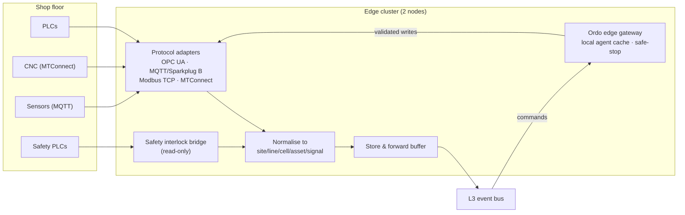

### Components

**Protocol adapters.** Translate each machine protocol into one internal form. The spec lists OPC UA, MQTT/Sparkplug B, Modbus TCP and MTConnect.
*Design detail:* every signal is published under a single hierarchical name, `site/line/cell/asset/signal` (for example `plant03/lineA/zoneA/cnc05/spindle_vibration_rms`). This is the "Unified Namespace" pattern. Each value carries a source timestamp, a quality flag (good / uncertain / bad) and units, so L3 and the agents never need to know which protocol it came from.

**Store & forward.** Buffers telemetry and events whenever the link to L3 is slow or down, then replays them in order when it returns.
*Design detail:* size the buffer for the longest outage you are willing to ride through (for example 24 hours of telemetry at full rate), drop or down-sample the lowest-priority signals first if it fills, and replay with original timestamps so the time-series store stays correct.

**Ordo edge gateway.** Receives commands from L3 (job orders, setpoints, AGV missions) and writes them to equipment through the adapters. Keeps a **local cache of agent models** so it can keep working briefly without the cloud. Implements **safe-stop**: if the cloud link drops, it completes the current safe step and holds.
*Design detail:* the gateway re-checks every write against the same hard limits the policy guard uses (setpoint ranges, quantities), so a corrupted or replayed command is still refused at the last step ("defence in depth"). Commands carry an id and expiry; the gateway rejects duplicates and anything expired.

**Safety interlock bridge.** Reads the state of safety PLCs so Ordo knows when a cell is stopped for safety reasons and can plan around it. It has **no write path**.

### Interfaces

| Direction | Content | Transport |
| --- | --- | --- |
| L1 → L2 | Signals, alarms, counts, measurements | Native protocols |
| L2 → L3 | Normalised telemetry, alarms, counts | Outbound-only connection over mutual TLS |
| L3 → L2 | Setpoints, job orders, AGV missions | Over the same outbound-initiated connection |
| L2 → L1 | Validated writes | Native protocols |

Because the plant initiates every connection outward, nothing on the internet can open a connection into the OT network.

**Candidate technologies:** HiveMQ Edge (open source), Litmus Edge, Kepware Server, Ignition, HighByte Intelligence Hub, Softing edgeConnector, Azure IoT Operations, AWS IoT SiteWise Edge / Greengrass v2.

---

## 6. L3 · Data platform

**Purpose.** The single source of truth for plant and run state. Everything L4 decides is based on L3, and everything L4 decides is written back to L3.

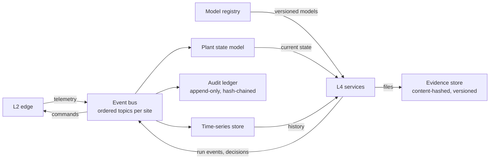

### Event bus
Ordered, per-site topics for telemetry, run events and decisions. It decouples producers from consumers: the edge does not know which agents read a signal, and agents do not know which machine produced it.
*Design detail:* partition topics by site and line so ordering holds where it matters (one line's events stay in sequence) while different lines scale independently. Keep separate topic families for telemetry (high volume, short retention), run and decision events (low volume, kept long), and commands (strictly ordered, acknowledged). See [section 11](#11-events-and-messages).

### Time-series store
High-rate machine and sensor signals: vibration, temperature, torque, counts.
*Design detail:* keep raw data for a short window (for example 30–90 days) and down-sampled aggregates (1 min, 1 h) for years. Agents read recent raw data; dashboards and capability studies read aggregates.

### Plant state model
The current picture of the plant: assets and their status, lots and their genealogy (which input lots produced which output lots), and the live state of every run and stage. The Floor & fleet screen and every agent read from it.
*Design detail:* build it as a projection of the event bus, so it can be rebuilt from history if it is ever corrupted. Genealogy is naturally a graph (lot → stage run → lot).

### Evidence store
Uploaded and agent-generated files: torque logs, SPC charts, CMM reports, photos, lab certificates. Files are **content-hashed**; a changed file becomes a new version and earlier versions stay in the record.

### Audit ledger
Append-only, hash-chained record of every decision, signature and change. Each entry stores the time, the actor, the action, the hash of its payload and the hash of the previous entry.

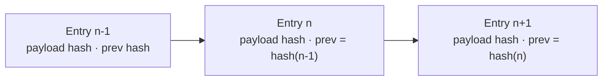

Changing or deleting any entry breaks every hash after it, so tampering is detectable by re-walking the chain.
*Design detail:* periodically anchor the latest hash somewhere outside the system (a signed daily checkpoint), so even a full database rewrite would be detected.

### Model registry
Versioned agent and prediction models with their evaluation results. Agents load models from here; the edge caches copies. Every decision can be traced to the exact model version that produced it.

**Candidate technologies:** event bus — Kafka / Confluent, EMQX or HiveMQ (MQTT), Azure Event Hubs / Fabric Eventstream; time series — TimescaleDB, InfluxDB 3, AWS IoT SiteWise; plant state — Postgres (with TimescaleDB for both), Cognite Data Fusion; evidence — object storage with content hashing.

---

## 7. L4 · Orchestration core

**Purpose.** Where every decision is made and checked. L4 services are **stateless and horizontally scaled**; durable state lives in L3.

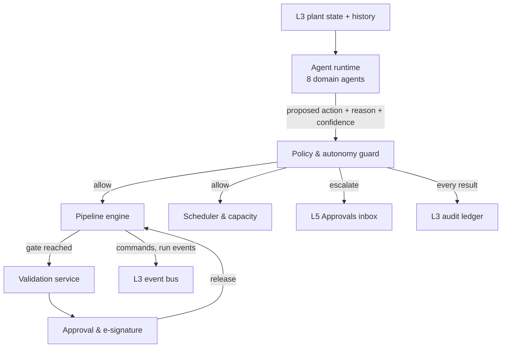

### 7.1 Pipeline engine

Executes stage graphs (DAGs) with branches, merges, rework loops, retries and timeouts, and keeps durable state per run.

**How a template becomes a run.** A template defines stages arranged in columns. Each stage has an agent, a resource, an execution mode (Auto, Approve, Manual), success criteria, a timeout and an escalation role. Starting a run instantiates every stage as a *stage run* in state **Queued**.

**Execution rules.**
- Stages in the same column run in parallel and are numbered with a letter suffix (`02a`, `02b`).
- When two adjacent columns have the same number of parallel stages, each lane continues independently; otherwise lanes **merge** into the next stage, which starts only when all its inputs are complete.
- A **rework loop** sends units from a later stage back to an earlier one (for example Quality inspection → Sub-assembly in Discrete assembly).
- A stage advances when its **success criteria** are met. With mode *Approve* (or a gate required by the autonomy level) it stops at **Awaiting approval** until a person releases it.
- A held gate pauses downstream scheduling.
- If a stage exceeds its **timeout**, the engine escalates to the stage's escalation role.

**Stage lifecycle.**

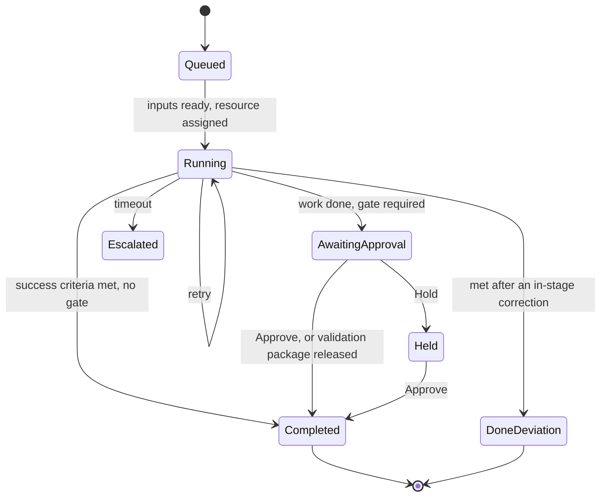

*Design detail:* store run state as a sequence of events (stage started, decision made, gate released…) and derive the current state from them. That makes runs durable across restarts, lets any L4 instance resume a run, and gives the ledger a complete history for free.

### 7.2 Agent runtime

Hosts the eight domain agents and supplies them with plant state and models. Each agent is scoped to certain stage types and resources, and can only propose actions within that scope.

| Agent | Scope | Reads | Typical actions |
| --- | --- | --- | --- |
| Planning | Orders, capacity | ERP orders, capacity, due dates, supplier lead times | Merge orders, reserve capacity, flag due-date risk |
| Supply | Materials, AGVs | Stock, kits, AGV state, supplier data | Substitute approved parts, dispatch replenishment, quarantine lots |
| Scheduler | Machining cells | Spindle load, tool wear, queues | Split batches, swap tools early, resequence jobs |
| Line | Assembly | Station cycle times, torque, feeders | Rebalance stations, recalibrate tools, pause feeders |
| Process | Thermal, chemical | Temperatures, moisture, viscosity, profiles | Adjust setpoints, extend holds, hold batch for sampling |
| Vision QA | Inspection, release | Defect scores, measurements, Cpk | Raise sampling, route units to rework, release lots |
| Logistics | Packing, shipping | Pack line state, carrier ETAs | Consolidate shipments, reprioritise pallets |
| Maintenance | Asset health | Vibration, temperature, failure predictions | Open predictive work orders, schedule downtime, reserve spares |

The full stage-to-agent assignment for all 15 templates is in [pipeline-templates.md](pipeline-templates.md). The decision path every agent follows is in [agent-decision-model.md](agent-decision-model.md).

### 7.3 Policy & autonomy guard

Checks **every** proposed action, from agents and people alike, before it executes. The result is **allow**, **escalate** to a role, or **block**. See [section 10](#10-autonomy-and-the-policy-guard) for the full rules.

### 7.4 Validation service

Manages validation packages: scope, checks, evidence and readiness.
- Seeds checks from the stage's success criteria.
- Runs the **agent pre-check**: the owning agent fills every automated check from run data by comparing each measured value with its target, attaches generated evidence, and writes an assessment with confidence.
- Enforces readiness: a package can be submitted only when the pre-check has run, every check is recorded, no check has failed and all required evidence is attached.

Details: [validation-workflow.md](validation-workflow.md).

### 7.5 Approval & e-signature

Handles gate releases and ordered signature chains (Performed by → Reviewed by → Approved by).
- Only the role at the current step can sign.
- Each signature records signer, role, meaning, time and comment, and requires **re-authentication**.
- Request changes and Reject require a comment; a resubmitted package clears all later signatures.
- When the final signature lands, the outcome is applied (gate released, autonomy promoted, change made default) and written to the ledger.

### 7.6 Scheduler & capacity

Assigns stages to assets, balances load, resequences on disruption and forecasts ETA. In the prototype this drives the **Run ETA** metric and examples such as moving the remaining 60 parts from a degrading CNC-05 to CNC-07.
*Design detail:* treat schedule changes as agent proposals too, so they pass the policy guard and appear in the decision stream like any other action.

---

## 8. L5 · Experience

**Web console.** Seven screens: Pipelines (Flow, Graph, Ledger), Validation, Templates, Run history, Floor & fleet, Approvals, Builder. Live updates arrive over WebSocket. Screen-by-screen behaviour is in [product.md](product.md).

**Notification service.** Email, chat (Teams/Slack), andon boards and mobile push for gates, escalations and sign-off requests, so a person does not need the console open to be asked for a decision.

**API gateway.** REST and GraphQL, an event stream and webhooks, with authentication and rate limits. The console uses the same API as external clients. Endpoints and events: [integrations-api.md](integrations-api.md).

People connect over HTTPS and WebSocket and sign in through the corporate identity provider (SSO).

---

## 9. End-to-end flows

### 9.1 Sense: a signal reaches the agents

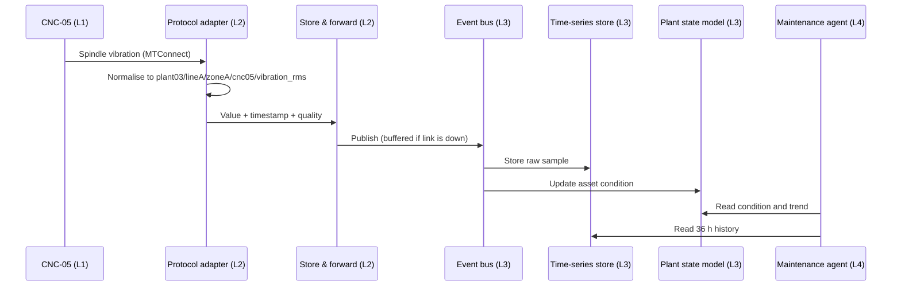

### 9.2 Decide and act: an agent action under L3 · Supervised

Example from the prototype: the Maintenance agent sees vibration on CNC-05 up 18% over 36 hours and a 0.22 failure probability within five days.

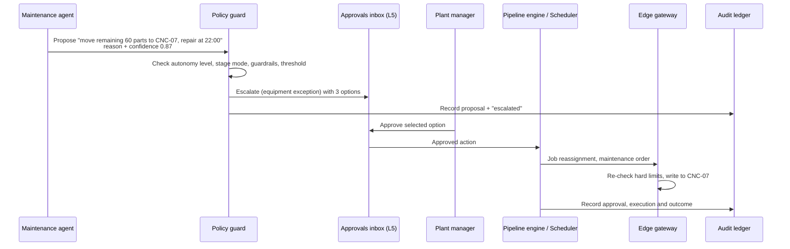

At **L4 · Autonomous** the same in-policy action would be allowed without escalation, and the plant manager would be notified instead.

### 9.3 Validate and sign: releasing a gate with evidence

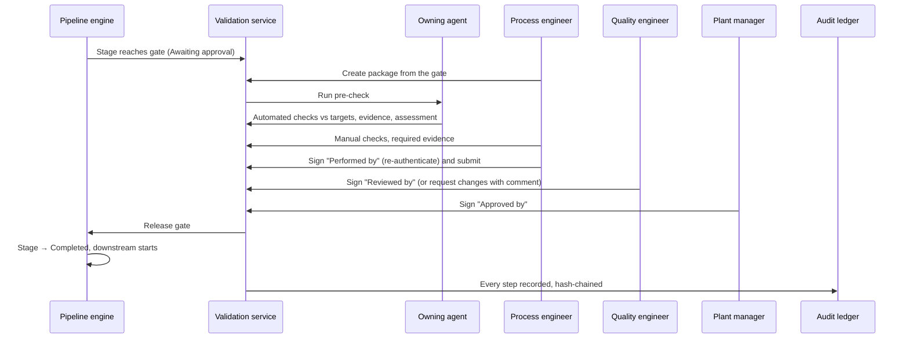

### 9.4 Cloud link lost

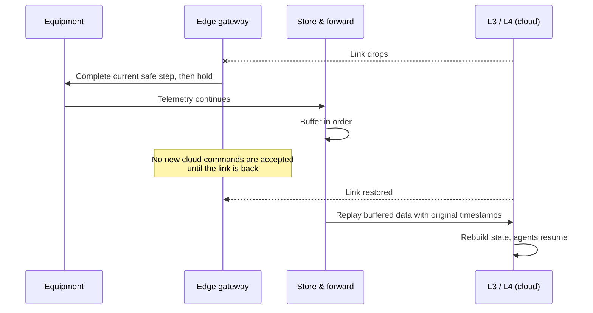

---

## 10. Autonomy and the policy guard

### Autonomy levels

| Level | Agents may | People must |
| --- | --- | --- |
| L1 · Assist | Monitor and suggest | Start every stage transition |
| L2 · Recommend | Plan and prepare actions | Confirm each decision |
| L3 · Supervised | Execute within guardrails | Sign quality gates and out-of-policy events |
| L4 · Autonomous | Execute end to end, including in-policy gates | Receive notifications; may intervene at any time |

Autonomy is set **per line** and can be **lowered for a single stage**. A validated stage can be **promoted one level** (for example L3 → L4) as the outcome of an approved validation package.

### What the guard checks

| Input | Example |
| --- | --- |
| Autonomy level of the line (or the lower stage override) | Line A at L3 |
| Execution mode of the stage | Approve → always needs a person |
| Guardrails | Setpoint limits, cost limits, quantity limits, safety constraints |
| Confidence threshold | Proposals below the threshold are escalated |
| Scope | The agent may only act on its own stage types and resources |

### Outcome matrix

| Situation | L1 | L2 | L3 | L4 |
| --- | --- | --- | --- | --- |
| Routine in-policy action | Suggest only | Escalate (confirm) | Allow | Allow |
| Stage transition | Escalate | Escalate | Allow | Allow |
| Quality gate | Escalate | Escalate | Escalate | Allow if in policy, notify |
| Out-of-policy action (breaks a guardrail) | Block / escalate | Block / escalate | Escalate | Escalate |
| Below confidence threshold | Escalate | Escalate | Escalate | Escalate |
| Touches safety systems | Block | Block | Block | Block |

*Design detail:* this matrix is a proposed reading of the v1.0 autonomy table. Making it an explicit, versioned policy file per site would let the plant manager review exactly what each level permits, and the ledger would record which policy version made each call.

---

## 11. Events and messages

### Event types (from the API)

`run.started`, `stage.state_changed`, `agent.decision`, `gate.awaiting`, `alert.raised`, `validation.submitted`, `validation.signed`, `validation.released`. They are delivered on the event stream and as webhooks.

### Topic layout (*design detail*)

| Topic family | Example | Volume | Retention | Ordering |
| --- | --- | --- | --- | --- |
| Telemetry | `plant03.lineA.telemetry` | Very high | Short (raw) | Per asset |
| Run events | `plant03.lineA.runs` | Low | Long | Per run |
| Decisions | `plant03.lineA.decisions` | Low | Long (also in ledger) | Per run |
| Commands | `plant03.lineA.commands` | Low | Short, acknowledged | Strict per asset |
| Alerts | `plant03.alerts` | Low | Long | Per site |

### Example messages (*design detail*)

Telemetry sample:

```json
{
  "name": "plant03/lineA/zoneA/cnc05/spindle_vibration_rms",
  "value": 4.82,
  "unit": "mm/s",
  "ts": "2026-10-01T12:48:03.120Z",
  "quality": "good",
  "source": "mtconnect"
}
```

Agent decision (`agent.decision`):

```json
{
  "id": "dec_01J9Z8...",
  "run": "R-2417",
  "stage": "05a",
  "agent": "Maintenance agent",
  "modelVersion": "maint-vib-2026.09.2",
  "action": "Move remaining 60 parts to CNC-07; repair CNC-05 at 22:00",
  "reason": "Vibration RMS +18% over 36 h; bearing +8 °C; P(failure 5d) = 0.22",
  "confidence": 0.87,
  "alternatives": ["Run to completion, then repair", "Stop CNC-05 now"],
  "policy": { "level": "L3", "result": "escalated", "role": "Plant manager" },
  "ts": "2026-10-01T12:48:10Z"
}
```

Audit entry:

```json
{
  "seq": 184223,
  "ts": "2026-10-01T13:12:04Z",
  "actor": "M. Okafor",
  "action": "validation.signed",
  "payloadHash": "sha256:9f2c…",
  "prevHash": "sha256:41ab…"
}
```

---

## 12. Enterprise integration

| System | Direction | Data | Used by |
| --- | --- | --- | --- |
| ERP | In / out | Orders, BOMs, inventory, costs; confirmations back | Planning, Supply |
| MES | In / out | Work orders, routings, counts, genealogy | Pipeline engine, plant state |
| QMS | Out | Deviations, CAPA triggers, approved validation records | Validation, Vision QA |
| CMMS | In / out | Maintenance work orders, spares | Maintenance |
| WMS | In / out | Stock locations, picks, kit status | Supply, Logistics |
| PLM | In | Drawings, revisions, engineering change requests | Process engineers, validation |
| Identity provider | In | SSO (SAML / OIDC), groups mapped to roles | All of L5 |
| Shop floor | In / out | OPC UA, MQTT / Sparkplug B, Modbus TCP, MTConnect | L2 |

An integration hub connects these at L3/L4 through **versioned connectors** and the event bus. Versioning means a change in an ERP's interface ships as a new connector version without touching the orchestration core.

---

## 13. Cross-cutting concerns

| Concern | How it is handled |
| --- | --- |
| Identity & RBAC | SSO via the corporate identity provider; role-based access per site and line; signing rights bound to roles |
| Electronic signatures | Signer, role, meaning, time, comment; re-authentication required. Designed to support 21 CFR Part 11 and EU GMP Annex 11; qualification is the customer's responsibility |
| Records | Append-only, hash-chained audit ledger; content-hashed, versioned evidence; retention configurable per site |
| Observability | Logs, traces and agent metrics (decisions, escalations, confidence over time) |
| Secrets & keys | KMS; signing keys for e-signatures and ledger checkpoints |
| Multi-site tenancy | Org → site → line isolation for data, policies and permissions |
| Network | Segmented OT network; outbound-only mutual TLS from edge to cloud |

More detail: [security-compliance.md](security-compliance.md).

---

## 14. Deployment and availability

| Component | Where it runs | Notes |
| --- | --- | --- |
| L3–L5 services | Cloud (single-tenant) or customer data center | Containerised; horizontally scaled |
| Edge gateway | On-premise, per plant | Two-node cluster; store-and-forward buffer |
| Agent models | Cloud, with cached copies at the edge | Versioned in the model registry |
| Console | Browser | Desktop-first; tablet for floor use |

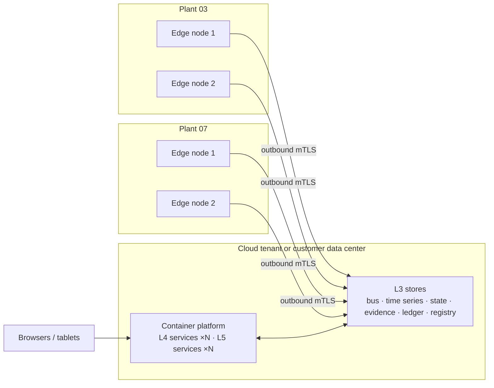

**Scaling.** L4 and L5 scale by adding instances because they hold no state. L3 scales by partitioning per site and line. Each plant's edge cluster is sized for that plant only, so adding a plant adds an edge cluster without changing the others.

---

## 15. Failure modes

| Failure | Effect | Built-in response |
| --- | --- | --- |
| Cloud link lost | No new cloud decisions | Edge completes current safe step and holds; telemetry buffered and replayed |
| One edge node fails | — | Second node of the cluster takes over |
| L4 instance crashes | — | Stateless; another instance resumes from L3 run state |
| Agent proposes something unsafe or out of policy | — | Policy guard blocks or escalates; edge re-checks hard limits |
| Low-confidence decision | — | Escalated to a person regardless of autonomy level |
| Stage exceeds timeout | Run delayed | Escalation to the stage's escalation role |
| Bad sensor data | Wrong decisions | *Design detail:* quality flags from adapters; agents treat "uncertain"/"bad" as missing |
| Audit record tampered with | — | Hash chain breaks; detected on verification |
| Evidence file replaced | — | New content hash = new version; original kept |

---

## 16. Technology mapping

Options for each part of the architecture, drawn from [data-sources.md](data-sources.md). None are decided.

| Architecture part | Prototype / low-cost options | Production options |
| --- | --- | --- |
| L1 test data (no factory) | Microsoft OPC PLC simulator, Prosys Simulation Server, live MTConnect demo agent, replayed NASA / Azure PdM / Tennessee Eastman datasets | Real plant equipment |
| L2 edge | HiveMQ Edge, Litmus Edge Developer Edition | Litmus Edge, Kepware + HighByte, Ignition, Azure IoT Operations, AWS SiteWise Edge |
| L3 event bus | Self-hosted EMQX or Mosquitto | HiveMQ Enterprise / EMQX Dedicated + Confluent Kafka, Azure Event Grid / Fabric |
| L3 time series + state | TimescaleDB or InfluxDB 3 Core | Tiger Cloud, InfluxDB 3 Enterprise, AWS SiteWise, AVEVA PI, Cognite |
| External feeds | FRED, EIA / ENTSO-E, MoSPI API/MCP, Open-Meteo | LMElive / Metals-API, Freightos, project44, Electricity Maps, Interos / Resilinc |

Avoid retired services: AWS IoT Analytics, AWS IoT Events, Amazon Lookout for Equipment, Azure IoT Central (closed to new apps), Azure Time Series Insights, Google Cloud IoT Core.

---

## 17. Prototype versus target system

The repository contains a clickable prototype ([`Ordo Orchestrator.dc.html`](../Ordo%20Orchestrator.dc.html)), not a running system.

| Area | Prototype | Target system |
| --- | --- | --- |
| Plant data | Generated in the browser from fixed seeds | Live telemetry through L2 and L3 |
| Agents | Fixed example decisions per agent | Models from the registry acting on live state |
| Policy guard | Autonomy switch changes gate behaviour | Full guardrail and threshold evaluation |
| Pipeline engine | Step run advances one column; stops at gates | Event-driven execution with merges, loops, retries, timeouts |
| Validation & e-signature | Full workflow; "Acting as" switches roles; no re-authentication | Real identities, re-authentication, hash-chained ledger |
| Builder | Linear stage list; Publish only changes the label | Parallel lanes, loops, versioned templates |
| Gates | Placed on the current stage | Placed by stage mode and autonomy policy |

---

## 18. Open decisions

- Event bus: MQTT-only (UNS) versus MQTT at the edge bridged to Kafka in the cloud.
- Time-series and state store: one Postgres/TimescaleDB system versus separate stores.
- Cloud: Azure, AWS or Google Cloud reference deployment, or cloud-neutral.
- Exact policy matrix per autonomy level (section 10) and confidence thresholds per agent.
- Buffer size and outage duration the edge must survive.
- Retention periods for telemetry, run events, evidence and ledger, per site and regulation.
- How gates are placed in a running pipeline (stage mode versus autonomy policy) so the builder and runtime agree.
