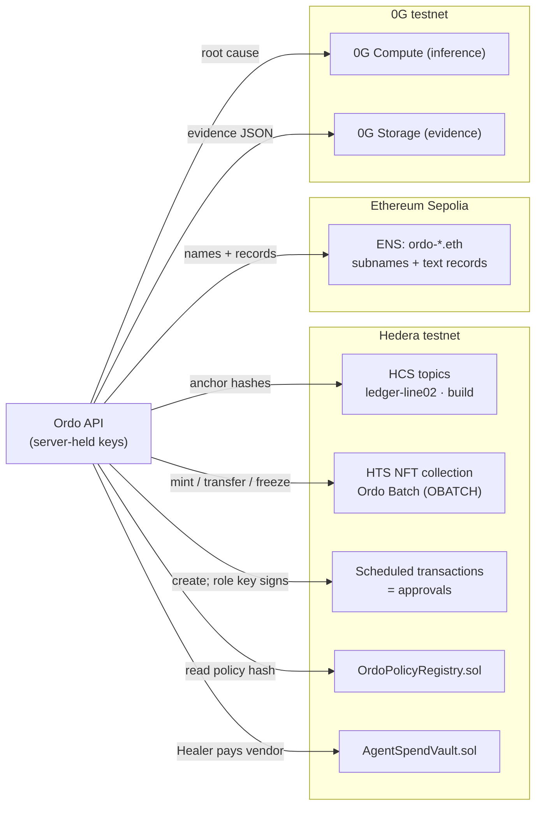

# Ordo — contracts and deployment plan

Companion to [technical-requirements.md](technical-requirements.md) (TRD). This file covers **everything on-chain** (accounts, native Hedera resources, Solidity contracts, ENS, 0G) and **everything we deploy** (database, API, web, CI/CD), in the order we do it.

> "Contract" in this file means **smart contracts and on-chain resources**. The **API contract** (zod schemas → OpenAPI) is TRD §3.1 and §11 and is built in milestone M0.

---

## 0. Timing and eligibility

| Work | When | Why |
| --- | --- | --- |
| Accounts, keys, faucets, ENS parent name, GCP / Neon / Vercel setup | **Now** | Setup, not project code |
| Contract **design** (this doc), interfaces in `packages/adapters` | **Now** | Design is allowed prior work |
| Solidity code, chain bootstrap scripts, `packages/adapters-chain` | **At the event (5–7 Nov)** by default | Keeps partner prizes possible (TRD §2) |
| App deployment (API, web, DB, CI/CD) | **Now** | Off-chain core |

If ETHGlobal confirms a pre-existing project is still eligible, or you decide to accept the risk, move the event rows forward. The steps below are identical either way.

---

## 1. On-chain architecture



| Component | Type | Needed for | Priority |
| --- | --- | --- | --- |
| HCS ledger topic per line | Hedera native | Audit anchor, Verify page | **Must** |
| HCS build topic | Hedera native | Proof of work at the event | **Must** |
| Role accounts with keys | Hedera native | Approvals enforced on-chain | **Must** |
| Scheduled transactions | Hedera native | Approve = sign | **Must** |
| `AgentSpendVault` | Solidity on Hedera EVM | Agent payment with hard caps | **Must** (Hedera agentic-payments qualifier) |
| HTS batch NFTs | Hedera native | Reroute / hold on-chain; tokenization track | Should |
| `OrdoPolicyRegistry` | Solidity on Hedera EVM | Proves which policy the guard used | Should |
| ENS names + text records | Sepolia, existing ENS contracts | Asset and agent identities | Should |
| ENS CCIP-Read gateway (live records) | Off-chain resolver | Creative ENS use | Stretch |
| 0G Compute / Storage | SDK only, no contract | 0G track | Should |

No custom contract is needed for HCS, HTS, scheduled transactions, ENS or 0G. Only two small Solidity contracts are ours.

---

## 2. Accounts and keys

All Hedera accounts use **ECDSA secp256k1** keys so the same key works with the Hedera SDK and EVM tools (Foundry, viem). For the MVP the API holds all keys server-side, one per role, and the UI "acting as" switch picks which key signs. Say so in the README. Wallet signing in the browser (HashPack / WalletConnect) is a stretch.

| Account | Holds | Used to | Fund with |
| --- | --- | --- | --- |
| `ordo-admin` | Admin of contracts, topic admin key | Deploy, configure, pause | 200 testnet HBAR |
| `ordo-api` | Topic submit key, HTS supply + freeze key | Write HCS messages, mint / freeze batches, pay fees | 300 HBAR |
| `role-operator` | Key that controls `line-02` | Sign L2/L3 approvals | 20 HBAR |
| `role-plant-manager` | Key required for high-risk approvals | Sign plant-manager approvals | 20 HBAR |
| `role-maintenance-lead` | Key for work-order release | Release vault escrow | 20 HBAR |
| `line-02`, `line-07` | Batch NFTs | Reroute = NFT transfer between them | 10 HBAR each |
| `agent-healer` | Vault `AGENT_ROLE` | Call `AgentSpendVault.pay / escrow` via Agent Kit | 20 HBAR |
| `vendor-acme` | Payee | Receives maintenance payments | 1 HBAR |
| EVM wallet (Sepolia) | ENS parent name | Create subnames, set records | 0.2 Sepolia ETH |
| EVM wallet (0G testnet) | 0G tokens | Compute broker deposit, storage fees | Faucet |

**Key handling.** Generate keys locally, store them in a password manager and in Secret Manager. Never commit them, never send them to the browser. `.env.example` lists names only. A `check-balances` script (§7) runs before every demo.

**On-chain role enforcement.** `line-02`'s account key is the operator's key, so a scheduled NFT transfer *out of* `line-02` cannot execute until the operator signs. High-risk reroutes use a `KeyList` threshold key (operator **and** plant manager). The policy guard decides who must approve; Hedera enforces it.

---

## 3. Hedera native resources

Created by one idempotent script, `chain/scripts/bootstrap-hedera.ts`, which writes every id to `chain/deployments/hedera-testnet.json` (committed). Re-running it checks existing ids instead of creating duplicates.

| Resource | Settings |
| --- | --- |
| Topic `ordo-ledger-line02` | `submitKey` = `ordo-api` (only Ordo can write), `adminKey` = `ordo-admin`, memo `ordo:ledger:LINE-02:v1` |
| Topic `ordo-build` | `submitKey` = `ordo-api`, memo `ordo:build` — commit-hash anchors (build plan §1.3) |
| NFT collection `Ordo Batch` / `OBATCH` | Non-fungible, finite supply 10 000, treasury `ordo-api`, `supplyKey` + `freezeKey` = `ordo-api`, no wipe key. Metadata = `ipfs`-free short JSON pointer: `{batch, line, units}` or a 0G Storage root hash |
| Token associations | `line-02`, `line-07` associated with `OBATCH` |

### 3.1 HCS message format (one per ledger anchor)

```json
{ "v": 1, "line": "LINE-02", "fromSeq": 120, "toSeq": 131, "entryHash": "sha256:…", "incident": "INC-0042", "evidence": "0g:0x…" }
```

Kept under the 1 024-byte single-chunk limit. Verify reads it back from the mirror node `GET /api/v1/topics/{topicId}/messages?sequencenumber={n}` and compares `entryHash`.

### 3.2 Approval as a scheduled transaction

1. Guard returns `require_approval(role)`.
2. API builds the inner transaction (e.g. `TransferTransaction` of batch NFT `line-02 → line-07`, or a vault `release` call) and wraps it in `ScheduleCreateTransaction` with memo `ordo:approval:<approvalId>`, paid by `ordo-api`. Store `scheduleId`.
3. UI shows "Awaiting signature from Operator" with the schedule on HashScan.
4. Approve → API submits `ScheduleSignTransaction` signed with that role's key → network executes when the key requirement is met.
5. Reject / override → schedule is left to expire (or deleted with the admin key) and the alternative path runs.
6. API listens on the mirror node for the executed transaction and records `approval.resolved` with the tx id.

Check on the day that the inner transaction type is schedulable (crypto/token transfers are; confirm contract calls on the current release). If contract calls are not schedulable, schedule the HBAR/NFT transfer and call the vault directly after execution.

---

## 4. Solidity contracts (Hedera EVM)

Foundry project in `chain/evm/`, Solidity 0.8.x, OpenZeppelin 5 (`AccessControl`, `Pausable`, `ReentrancyGuard`). RPC: Hashio testnet `https://testnet.hashio.io/api`, chain id **296**. Verify on Sourcify (`forge verify-contract --chain-id 296 --verifier sourcify`); verified source shows on HashScan.

### 4.1 `AgentSpendVault` — agents can pay, but only within hard limits

Why: Hedera's agentic-payments tracks need an AI agent to move value. Giving the agent a raw key with an HBAR balance contradicts Ordo's whole safety story. The vault makes the guardrails on-chain.

```solidity
// roles: DEFAULT_ADMIN_ROLE (ordo-admin), AGENT_ROLE (agent-healer), RELEASER_ROLE (role-maintenance-lead)
struct Caps { uint256 perTx; uint256 perDay; }
mapping(address => Caps) public caps;            // per agent
mapping(address => bool) public vendorAllowed;   // allow-listed payees
struct WorkOrder { address agent; address vendor; uint256 amount; uint64 expiresAt; uint8 status; bytes32 incidentHash; }
mapping(bytes32 => WorkOrder) public workOrders; // id = keccak(workOrderId)

function escrow(bytes32 id, address vendor, uint256 amount, uint64 ttl, bytes32 incidentHash) external onlyRole(AGENT_ROLE) whenNotPaused;
function release(bytes32 id) external onlyRole(RELEASER_ROLE) nonReentrant whenNotPaused;  // human confirms work done
function refund(bytes32 id) external;                                                     // anyone, after expiry
function pay(address vendor, uint256 amount, bytes32 incidentHash) external onlyRole(AGENT_ROLE) nonReentrant whenNotPaused; // small direct payments under perTx
function setCaps(address agent, Caps calldata c) external onlyRole(DEFAULT_ADMIN_ROLE);
function setVendor(address vendor, bool ok) external onlyRole(DEFAULT_ADMIN_ROLE);
function pause() / unpause() external onlyRole(DEFAULT_ADMIN_ROLE);                      // kill switch
event Escrowed(bytes32 indexed id, address indexed vendor, uint256 amount, bytes32 incidentHash);
event Released(bytes32 indexed id); event Refunded(bytes32 indexed id); event Paid(address indexed vendor, uint256 amount, bytes32 incidentHash);
```

Rules: reverts if vendor not allowed, amount > perTx, or the agent's rolling 24 h total would exceed perDay. `incidentHash` links every payment to the Ordo ledger entry.

**Tests (Foundry):** unit tests per function and role; fuzz `pay/escrow` amounts against caps; invariant "sum paid by an agent in any 24 h window ≤ perDay"; pause blocks everything except `refund`; reentrancy test with a malicious vendor.

**Hedera gotcha to test first:** HBAR has 8 decimals (tinybar) inside the EVM while JSON-RPC tools use 18-decimal weibar for `value`. Write one test transaction on testnet that funds the vault and reads `address(this).balance` before writing caps, and store caps in tinybar.

**Agent Kit wiring:** the Healer gets one custom Agent Kit tool, `ordo_vault_escrow`, built with `@hashgraph/hedera-agent-kit` v4 that calls the vault. The kit's generic transfer tools are **not** given to the agent.

### 4.2 `OrdoPolicyRegistry` — which policy made the call

```solidity
struct Policy { uint8 autonomyLevel; bytes32 policyHash; uint32 version; uint64 updatedAt; }
mapping(bytes32 => Policy) public policies;   // key = keccak("LINE-02")
function setPolicy(bytes32 line, uint8 level, bytes32 policyHash, uint32 version) external onlyRole(PLANT_MANAGER_ROLE);
event PolicyUpdated(bytes32 indexed line, uint8 level, bytes32 policyHash, uint32 version, address by);
```

The API hashes `policies/default.yaml` (canonical form) at startup and refuses to run L3/L4 automation if it differs from the registry. The Verify page shows "policy v1 ✔ matches on-chain". Changing autonomy in the UI becomes an on-chain, attributable event.

**Tests:** only plant manager can set; version must increase; event emitted.

### 4.3 Deployment steps

```bash
cd chain/evm
forge build && forge test -vvv
forge script script/Deploy.s.sol --rpc-url hedera_testnet --broadcast --slow   # deploys both, sets roles, caps, vendor allow-list
forge verify-contract <addr> src/AgentSpendVault.sol:AgentSpendVault --chain-id 296 --verifier sourcify
pnpm chain:export-abi   # writes ABIs + addresses to packages/chain-abi and chain/deployments/hedera-testnet.json
```

Then: fund the vault from `ordo-admin`, call `setPolicy` for LINE-02 with the hash of the policy file, and run the smoke script (§7).

Contracts are **immutable** — no proxies. A fix means deploy a new address, update `deployments/*.json`, redeploy the API. Fine for a testnet MVP and easier to audit.

---

## 5. ENS (Sepolia)

1. Register a parent name in the ENS app on Sepolia (e.g. `ordo-mfg.eth`) with the ENS wallet; wrap it (Name Wrapper).
2. `chain/scripts/ens-bootstrap.ts` (viem) creates subnames with the Public Resolver, e.g. `line02.ordo-mfg.eth`, `cnc05.line02.ordo-mfg.eth`, `cnc07.line02.ordo-mfg.eth`, `healer.agents.ordo-mfg.eth`, `maintenance.agents.ordo-mfg.eth`.
3. Records per name:
   - `addr` for Hedera: coin type `0x80000000 | 296` (ENSIP-11 EVM chain coin type) → the account's EVM address. Also plain ETH `addr` for Sepolia tooling.
   - Text: `description`, `url` (asset page in Ordo), `avatar`, `com.ordo.type` (`asset` / `line` / `agent`), `com.ordo.line`, `com.ordo.limits` (JSON of spec limits), `com.ordo.owner-agent`, `com.ordo.ledger-topic` (HCS topic id).
4. The API resolves names with viem (`getEnsName`, `getEnsText`) and caches them; the UI shows names wherever an id appears.
5. **Stretch:** an ENSIP-10 wildcard + CCIP-Read off-chain resolver on `line02.ordo-mfg.eth` so `*.line02…` returns **live** status (`com.ordo.status`, `com.ordo.health`) signed by the API. Any ENS-aware app then shows real machine state.

Take the Sepolia Registry, Name Wrapper and Public Resolver addresses from the official ENS deployments list on the day; do not hard-code addresses copied from blogs.

---

## 6. 0G (no contracts)

- Wallet funded from the 0G faucet; RPC `https://evmrpc-testnet.0g.ai`.
- **Compute:** create the serving broker, deposit to the ledger account, `listService()` to pick a model (testnet showed Qwen 2.5 7B, GPT-OSS-20B, Gemma 3 27B), call through the OpenAI-compatible endpoint with single-use request headers. Store `providerAddress` + `model` with each decision.
- **Storage:** `@0gfoundation/0g-ts-sdk`, indexer `https://indexer-storage-testnet-turbo.0g.ai`; upload evidence JSON, keep the Merkle root hash; download with proof on Verify.
- Package names differ between 0G pages (`@0glabs/0g-serving-broker` vs `@0gfoundation/0g-compute-ts-sdk`). Pick the one the current quickstart uses on the day.

---

## 7. Chain scripts (all in `chain/scripts/`, run with `pnpm chain:<name>`)

| Script | Does | Run |
| --- | --- | --- |
| `create-accounts` | Creates the Hedera accounts in §2, prints ids and keys once | Once |
| `bootstrap-hedera` | Topics, NFT collection, associations; writes deployments file | Once, idempotent |
| `deploy-evm` | Wraps `forge script` + verify + ABI export | Once per contract version |
| `ens-bootstrap` | Subnames + records from `chain/ens.yaml` | Once, idempotent |
| `check-balances` | HBAR per account, vault balance, 0G balance + broker deposit, Sepolia ETH; fails under thresholds | Before every demo, and in CI nightly |
| `smoke-chain` | One HCS message, one schedule create+sign, one vault escrow+release, one ENS read, one 0G call; prints HashScan links | After any chain change |
| `anchor-build` | Posts `git rev-parse HEAD` to the build topic | Every ~3 h at the event |

---

## 8. Application deployment

### 8.1 Environments

| Env | Web | API | DB | Chains | LLM |
| --- | --- | --- | --- | --- | --- |
| Local | `pnpm dev` :3000 | `pnpm dev` :8080 | Docker Postgres 16 | Local adapters (or testnet with your own keys) | Recorded or Gemini |
| Preview (per PR) | Vercel preview | — (uses demo API, read-only) or local | — | — | — |
| Demo (prod) | Vercel production | Cloud Run `ordo-api`, region **asia-south1 (Mumbai)** | Neon `main` | Testnets | Gemini live, recorded fallback |

### 8.2 One-time setup, in order

1. **Rename the repo to `ordo` first.** Workload Identity Federation (step 4) is bound to the repo name.
2. **GCP project** `ordo-demo`: billing on, **budget alert at USD 20**. Enable `run`, `artifactregistry`, `secretmanager`, `iamcredentials`, `sts`, `logging`.
3. **Artifact Registry** Docker repo `ordo` in `asia-south1`.
4. **Service accounts.** `ordo-api-runtime` (Secret Manager accessor only). `ordo-deployer` (Cloud Run admin, Artifact Registry writer, act-as `ordo-api-runtime`). **Workload Identity Federation** pool + GitHub OIDC provider with attribute condition `assertion.repository == 'AloysJehwin/ordo'`. No JSON keys anywhere.
5. **Neon** project in an Asia region; database `ordo`; copy the **pooled** URL (app) and **direct** URL (migrations).
6. **Secret Manager:** `DATABASE_URL`, `DATABASE_URL_DIRECT`, `GEMINI_API_KEY`, `LEDGER_SIGNING_KEY`; event-time additions: `HEDERA_*`, `ZG_*`, `ENS_*` keys.
7. **Vercel** project from the repo, root `apps/web`, env `NEXT_PUBLIC_API_URL` = Cloud Run URL. Previews on PRs, production on `main`.
8. **GitHub:** branch protection on `main` (CI green + 1 review); repo variables `GCP_PROJECT`, `GCP_REGION`, `WIF_PROVIDER`, `DEPLOYER_SA`.

### 8.3 API container

Multi-stage Dockerfile at `apps/api/Dockerfile`: build with pnpm + Turborepo, `pnpm deploy --filter api --prod /out`, run as non-root on `node:22-slim`, listen on `$PORT`, `/health` for probes.

### 8.4 Cloud Run settings (and why)

| Setting | Value | Reason |
| --- | --- | --- |
| Min / max instances | **1 / 1** | Simulator, in-process event bus and single ledger writer live in one process. Two instances would run two plants and fork the ledger |
| CPU | Always allocated, 1 vCPU, 1 GiB | Simulator ticks and SSE need CPU between requests |
| Request timeout | 3600 s | SSE streams; the client reconnects with `Last-Event-ID` |
| Concurrency | 80 | Plenty for a demo |
| Ingress | All; CORS limited to the Vercel domains | |
| Startup probe | `/health` | |

Scaling past one instance later means moving the bus to Pub/Sub or Postgres `LISTEN/NOTIFY` and the simulator to a separate job. Not needed for the MVP.

### 8.5 CI/CD workflows (`.github/workflows/`)

| Workflow | Trigger | Steps |
| --- | --- | --- |
| `ci.yml` | Every PR and push | pnpm install (cached) → Biome → typecheck → unit → integration (Postgres service container) → Playwright e2e in recorded mode |
| `contracts.yml` | PR touching `chain/evm/**` | `forge fmt --check`, `forge build`, `forge test` incl. fuzz and invariants |
| `deploy-api.yml` | Push to `main` touching `apps/api`, `packages/**` | auth (WIF) → build + push image tagged with commit SHA → **migrate** (direct URL, backward-compatible migrations only) → deploy Cloud Run → smoke `/health` + `/v1/openapi.json` + recorded scenario → on failure, route traffic back to the previous revision |
| Web | Vercel Git integration | Automatic previews and production |
| `chain-deploy.yml` | **Manual only** (`workflow_dispatch`, environment with required reviewer) | Runs a named chain script with secrets; never automatic |
| `nightly.yml` | Cron | `check-balances`, Playwright against production, live LLM smoke |

### 8.6 Rollback

- API: `gcloud run services update-traffic ordo-api --to-revisions=<previous>=100 --region asia-south1`.
- Web: Vercel "Instant Rollback" to the previous production deployment.
- DB: migrations are additive; Neon point-in-time restore as last resort.
- Contracts: deploy a new address and update `deployments/*.json`; the old one stays paused.

---

## 9. Demo-day runbook

1. **T-24 h:** `pnpm chain:check-balances`; top up from faucets. Re-check SDK versions and the Gemini model id.
2. **T-2 h:** confirm Cloud Run min instance is warm; `POST /v1/sim/reset`; reseed DB; run `smoke-chain`.
3. **T-15 min:** open dashboard, Ledger and HashScan tabs; set `DEMO_MODE=live`; keep the recorded-mode URL and the backup video ready.
4. **During:** if an LLM or chain call exceeds its budget, the app falls back automatically and labels it; keep going.
5. **After:** export the incident's ledger and HashScan links for the submission.

---

## 10. Step-by-step order (who and when)

| # | Step | Owner | When |
| --- | --- | --- | --- |
| 1 | Rename repo to `ordo` | Aloys | Today |
| 2 | GCP project, budget, APIs, Artifact Registry, service accounts, WIF (§8.2 1–4) | Srushti | 20 Oct |
| 3 | Neon DB, Secret Manager entries, Vercel project (§8.2 5–8) | Aloys | 20 Oct |
| 4 | Monorepo scaffold, `ci.yml`, Dockerfile, `deploy-api.yml`; `/health` live on Cloud Run, shell live on Vercel | Both | 21 Oct (TRD M0) |
| 5 | Hedera accounts created + funded; keys in password manager | Srushti | by 25 Oct |
| 6 | Sepolia ENS parent name registered and wrapped; 0G wallet funded | Aloys | by 25 Oct |
| 7 | Contract and script **designs** reviewed against this doc (no code) | Both | by 1 Nov |
| 8 | Tag `pre-ethglobal`, write `PRIOR_WORK.md` | Both | 4 Nov |
| 9 | Event: `bootstrap-hedera`, HCS anchor adapter, first build anchor | Srushti | Event h 0–4 |
| 10 | Event: Foundry contracts + tests, deploy + verify, policy hash set, vault funded | Srushti | Event h 4–14 |
| 11 | Event: scheduled-transaction approvals, Agent Kit vault tool, batch NFTs | Srushti | Event h 14–24 |
| 12 | Event: 0G compute + storage adapters, ENS bootstrap + names in UI | Aloys | Event h 4–24 |
| 13 | Event: `smoke-chain`, `check-balances`, production deploy, demo run, submission | Both | Event h 24–34 |

If you decide to build the chain parts before the event, steps 9–12 move to 26 Oct–1 Nov with no other change.
