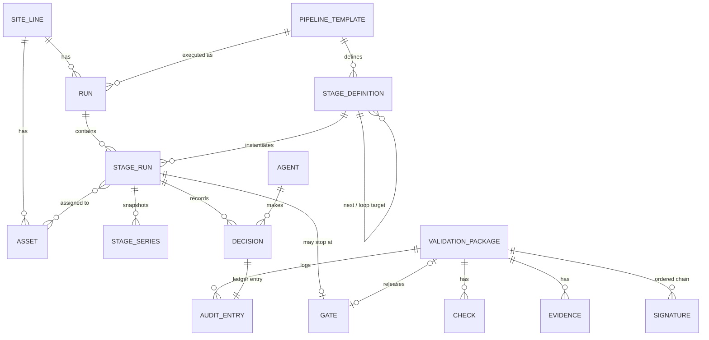

# Data model

## Entities

| Entity | Key fields | Relationships |
| --- | --- | --- |
| Site / Line | id, name, timezone, autonomy level | has many Assets, Runs |
| Pipeline template | id, name, category, version, status | has many Stage definitions |
| Stage definition | name, column, lane, agent, resource, mode, criteria (parameters: kind, signal, aggregate, target or range, unit), timeout, escalation role | belongs to Template; edges to next stages; optional loop target |
| Run | id, template version, order ref, started, ETA, status | has many Stage runs |
| Stage run | state, progress, yield, throughput, start, end, parameter results (value, band, pass) | has Decisions, Alerts, Metrics, Inputs, Outputs, Stage series |
| Stage series | run, stage, signal, time, value | the signals a stage's parameters read, snapshotted (at most 120 points per signal) when its work finishes; belongs to Stage run |
| Measurement reading | run, stage, criterion (label or `label#max`), signer, signer kind, value × 10⁴ and salt (private), commitment, anchor, signature, matches | one bound of a measured parameter as its source signed it (`OrdoMeasurement`); the commitment the parameter's proof opens when the value is the one Ordo recorded; belongs to Stage run |
| Decision | time, agent, action, reason, confidence, policy result | belongs to Stage run; ledger entry |
| Asset | id, type, zone, status, utilization, OEE | assigned to Stage runs |
| Agent | id, scope, autonomy level, model version | makes Decisions |
| Gate | stage run, required role, status | optionally released by a Validation package |
| Validation package | id, type, title, owner, status, objective, acceptance, sample plan, window, outcome on approval | has Checks, Evidence, Signatures, Audit entries; links to Template, Stage, Gate |
| Check | criterion, method, target, result, source (agent/manual), status | belongs to Validation package |
| Evidence | name, required/optional/agent-generated, file ref, hash, uploader, time | belongs to Validation package; file in Evidence store |
| Signature | role, meaning, signer, time, comment, auth method | ordered chain on Validation package |
| Audit entry | time, actor, action, payload hash, previous hash | append-only, chained |

## Relationships

## Notes

- **Audit entries** are hash-chained: each stores the hash of its payload and the hash of the previous entry, so any change breaks the chain.
- **Evidence** files are content-hashed on upload. A changed file is a new version; earlier versions stay in the record.
- **Rolled yield** for a run is the product of the yields of all completed stages.
- **Parameters** are judged from measured data only: counts and time, or a signal of the stage's asset over the stage window. Telemetry is kept for seven days; the series a stage's parameters read is copied to **stage series** when the stage's work finishes, so the run's record is complete after the telemetry is gone. Measured values are visible to signed-in users only; the public passport shows bands and proof status.
- **Who committed to a value.** When the stage's asset has a gateway, the gateway signs one `OrdoMeasurement` per bound from its own readings (a **measurement reading**); its commitment, not Ordo's, is what the zero-knowledge proof opens, and the release folds it into the proof root that `OrdoLotResolver` verifies. A parameter Ordo committed to itself (a manual asset, an operator's reading, counts) is proven on the passport but stays off the chain.
- **Completion by phase.** A stage with `completeOn` (signal and value) closes when its asset reports that phase after the stage started, instead of when counts reach the order quantity; the whole order then counts as made.
