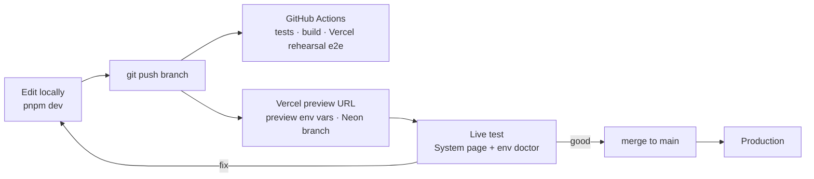

# Environments, configuration and live testing

One place holds every setting for every environment: **Vercel project environment variables**. Local work pulls from it, preview deployments read it per branch, production reads it on promote. Nothing secret lives in the repo.

## The three environments

| Environment | URL | Database | Rails | Used for |
| --- | --- | --- | --- | --- |
| **Development** | `localhost:5173` (or `:8080`) | Embedded PGlite, or a Neon dev branch | Whatever is in your pulled `.env` | Building and debugging |
| **Preview** | one URL per branch / pull request, e.g. `ordo-git-feat-x.vercel.app` | Neon branch per preview (automatic with the Neon integration) | Testnets (Hedera, Sepolia, 0G) + Gemini | **Live testing and rework**: every push gets a fresh live URL |
| **Production** | `ordo.vercel.app` (or your domain) | Neon `main` | Testnets for the hackathon | The judge demo |

## How a change flows (the rework loop)



1. Work locally with `pnpm dev`. Pull settings with `npx vercel env pull server/.env --environment=development`.
2. Push a branch. Vercel builds a **preview** deployment with the **Preview** variables, and the Neon integration gives it its own database branch, so test data never touches production.
3. Open the preview URL and sign in with your wallet. **Settings** shows which rails are live (database, identity, signatures, AI, anchor, payments, policy registry) and the commit it runs.
4. Fix and push again; the preview URL updates. Merge to `main` to ship to production. Roll back with **Instant Rollback** in the Vercel dashboard if needed.

## One-time setup

```bash
npm i -g vercel                     # or use npx vercel
vercel login
vercel link                         # in the repo root; creates .vercel/project.json (git-ignored)
```

In the Vercel dashboard:

1. **Import the GitHub repo** (`AloysJehwin/ordo`). Root directory: repo root. The included `vercel.json` sets the install and build commands; leave the framework as "Other".
2. **Storage → Marketplace → Neon → Add.** Connect it to the project for Production, Preview and Development. It sets `DATABASE_URL` for you and creates a database branch per preview deployment.
3. **Settings → Environment Variables:** add the variables below, or push them from a file with the script (next section).
4. **Settings → Deployment Protection:** keep Vercel Authentication on for previews if only you test them; turn it off for production so judges can open it. Access inside the app is by wallet sign-in and per-site roles. Set `BOOTSTRAP_ADMIN_ADDRESS` to your wallet if only you may create sites.

## Keeping variables in sync

Keep local, git-ignored files per environment (`.env.preview`, `.env.production`) as your working copies, and push them:

```bash
export VERCEL_TOKEN=...             # vercel.com/account/tokens — never commit it
pnpm env:vercel status              # table: which variable is set in production / preview / development
pnpm env:vercel push .env.preview preview
pnpm env:vercel push .env.production production
npx vercel env pull server/.env --environment=development
```

The push uses Vercel's API with upsert, marks keys, secrets, passcodes and database URLs as **sensitive** (write-only in the dashboard), and never prints values. Variables take effect on the next deployment.

## Check before you test: env doctor

```bash
pnpm env:doctor                                                   # local .env
npx vercel env pull .env.preview --environment=preview && \
  (cd server && node --env-file=../.env.preview --import tsx scripts/doctor.ts)
```

It validates every variable and checks each configured rail against the real service: database and schema, Gemini model, Hedera operator balance, ledger topic, JSON-RPC chain id, vault deployment and balance, policy registry match, ENS reverse resolution, 0G endpoints. It exits non-zero on any failure, so it can gate a deploy.

## Variables

| Variable | Dev | Preview | Prod | Notes |
| --- | --- | --- | --- | --- |
| `DATABASE_URL` | optional | Neon (auto) | Neon (auto) | Required on Vercel |
| `LEDGER_SIGNING_KEY` | optional | **set** | **set** | Same value everywhere you want anchors to verify. Generate: see `server/.env.example` |
| `BOOTSTRAP_ADMIN_ADDRESS` | optional | optional | **set** | Only this wallet may create sites. Unset: any signed-in wallet creates its own site |
| `SESSION_TTL_HOURS` | 72 | 72 | 72 | Wallet session length |
| `AUTH_RPC_URL` | – | optional | optional | Lets smart-contract wallets (ERC-1271) sign in and sign decisions |
| `SIGNATURE_CHAIN_ID` | 296 | 296 | 296 | Chain id in EIP-712 signatures when the wallet does not report one |
| `ANCHOR_EVERY` | 50 | 50 | 50 | Anchor the ledger head after this many new entries (and every 30 min) |
| `TRUST_RPC_URL`, `TRUST_CHAIN_ID`, `TRUST_CONTRACT_ADDRESS`, `TRUST_RELAYER_KEY` (+ `TRUST_CHAIN_NAME`, `TRUST_EXPLORER_URL`, `TRUST_SYMBOL`, `TRUST_DECIMALS`) | – | Hedera testnet | Hedera testnet | OrdoTrust: on-chain role credentials, validator stakes, release records, slashing. From `pnpm --filter @ordo/contracts deploy:trust`. Without them validators are approved in-app only |
| `LLM_PROVIDER`, `GEMINI_API_KEY`, `GEMINI_MODEL` | offline or gemini | gemini | gemini | `gemini-flash-latest` tracks the current Flash model |
| `ANCHOR`, `PAYMENTS` | local/mock | hedera | hedera | Decisions are signed with each person's wallet (EIP-712), so there is no approvals rail |
| `HEDERA_*` | – | testnet | testnet | From `pnpm --filter @ordo/contracts bootstrap:hedera` and `deploy:hedera` |
| `IDENTITY`, `ENS_RPC_URL` | plain | ens | ens | `ens` shows people's primary ENS names (mainnet reverse resolution) |
| `EVIDENCE_STORE`, `ZG_*` | local | 0g (optional) | 0g (optional) | |

Use separate Hedera accounts for preview and production if several people test at once, so testnet balances and topics don't mix.

## How Ordo runs on Vercel

Vercel functions are short-lived, so Ordo keeps no state in memory: everything is in Postgres. Each console poll of `/v1/sites/:id/live` runs one engine cycle at most every 4 seconds across all instances (a database lease): pull new data from MTConnect agents and dataset replays, advance runs from part counters, let the agents scan for anomalies, and anchor the ledger head when due. The same build runs as a long-lived Docker container, where a timer also runs the cycle when nobody is watching.

There is no simulator and no sample data. Data comes from MTConnect agents reachable over the internet (for example `https://demo.mtconnect.org`), CSV datasets recorded from real machines and uploaded per asset, or readings operators enter. Private network addresses are refused from the cloud deployment; for machines on a plant network, run the Docker image on that network.

Build locally exactly as Vercel does, and rehearse it against a real Postgres:

```bash
pnpm vercel-build
DATABASE_URL=postgres://... VERCEL=1 PORT=3000 pnpm vercel-local    # serves .vercel/output with Vercel's routing
E2E_TARGET=vercel E2E_DATABASE_URL=postgres://... pnpm e2e          # full console flow in a browser, no background timer
```
