# Product overview

## What Ordo does

Ordo coordinates production work across machines, robots, vehicles and people. A production process is modelled as a **pipeline**: a directed graph of **stages** that can branch into parallel work and merge back. Software **agents** run each stage against live plant data: they plan, assign resources, adjust parameters and decide when a stage is complete. Every decision is logged with its reason and a confidence score.

People stay in control through three mechanisms:

- The **autonomy level** sets how much agents may do without asking.
- **Approval gates** stop a pipeline at points where a person must sign off.
- **Validation packages** require a process engineer to prove that a stage, process change or new pipeline works, with measured checks and attached evidence, before quality and management sign it into use.

## Roles

| Role | Primary use of Ordo |
| --- | --- |
| Operator | Executes manual stages, records manual checks, raises holds |
| Process engineer | Builds pipelines, prepares validation packages, attaches proof |
| Quality engineer | Reviews checks and evidence, signs quality gates, requests changes |
| Plant manager | Final approval, sets autonomy level per line, handles escalations |
| Administrator | Users, roles, sites, connectors, policies |

## Core concepts

### Pipeline and stage

A pipeline is a template plus a run. The **template** defines stages, their order, parallel branches, rework loops, the agent and resource for each stage, its success criteria, timeout and escalation role. A **run** is one execution of a template against an order or batch, identified like `R-2417`.

Stages in the same column run in parallel and are numbered with a letter suffix (`02a`, `02b`). When two adjacent columns have the same number of parallel stages, each lane continues on its own; otherwise lanes merge into the next stage. A rework loop sends units from a later stage back to an earlier one.

### Node states

| State | Node mark | Meaning |
| --- | --- | --- |
| Queued | Dashed grey circle | Waiting on upstream stages; capacity pre-allocated |
| Running | Gold circle with halo | Agent executing; progress, throughput and ETA live |
| Awaiting approval | Gold rounded square | Work complete; a person must release the gate |
| Held by operator | Red rounded square | Gate held; downstream scheduling paused |
| Done · deviation | Red ring | Completed after an in-stage correction; deviation logged |
| Completed | Solid dark circle | Output released to the next stage |

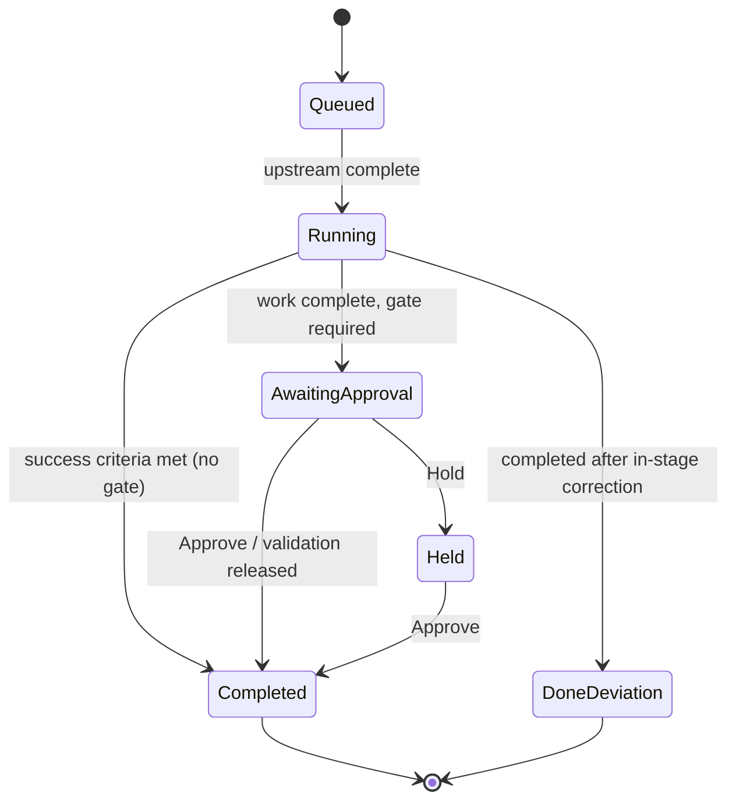

### Agents

Eight domain agents are deployed per site. Each is scoped to a set of stage types and resources.

| Agent | Scope | Typical decisions |
| --- | --- | --- |
| Planning | Orders, capacity | Merge orders, reserve capacity, flag due-date risk |
| Supply | Materials, AGVs | Substitute approved parts, dispatch replenishment, quarantine lots |
| Scheduler | Machining cells | Split batches, swap tools early, resequence jobs |
| Line | Assembly | Rebalance stations, recalibrate tools, pause feeders |
| Process | Thermal, chemical | Adjust setpoints, extend holds, hold batch for sampling |
| Vision QA | Inspection, release | Raise sampling, route units to rework, release lots |
| Logistics | Packing, shipping | Consolidate shipments, reprioritize pallets |
| Maintenance | Asset health | Open predictive work orders, schedule downtime, reserve spares |

Which agent owns each template stage is listed in [pipeline-templates.md](pipeline-templates.md).

### Autonomy levels

| Level | Agents may | People must |
| --- | --- | --- |
| L1 · Assist | Monitor and suggest | Start every stage transition |
| L2 · Recommend | Plan and prepare actions | Confirm each decision |
| L3 · Supervised | Execute within guardrails | Sign quality gates and out-of-policy events |
| L4 · Autonomous | Execute end to end, including in-policy gates | Receive notifications; may intervene at any time |

Autonomy is set per line and can be lowered for a single stage. A validated stage can be promoted one level (for example L3 → L4) as the outcome of an approved validation package.

### Gates and validation packages

A **gate** is a stop point inside a run. It can be released directly (Approve), held (Hold), or released through a validation package. A **validation package** is a formal record that proves a stage, process change, pilot, machine qualification or proof of concept meets stated acceptance criteria. It contains scope, checks, evidence, a signature chain and an audit trail. See [validation-workflow.md](validation-workflow.md).

## Screens

The console has seven screens, reached from the left navigation. Counts beside Validation and Approvals show items waiting on the current user. The clickable prototype is [`Ordo Orchestrator.dc.html`](../Ordo%20Orchestrator.dc.html).

### Pipelines

The header shows the run, template selector, view switch (Flow, Graph, Ledger), **Step run** and **Edit in builder**. Below it are the autonomy control and six run metrics: progress, rolled yield, live throughput, run ETA, agent decisions and pending gates. The decision stream at the bottom lists the latest agent decisions with reason and confidence.

**Step run** advances the run one column. It stops at a gate that is awaiting approval or held and opens that gate instead. Approving a gate completes its stage.

- **Flow:** each stage is a numbered node. Edge colour follows the downstream state: dark for completed, gold for active, dashed grey for queued.
- **Graph:** the same graph with compact cards on a dot grid, for dense pipelines.
- **Ledger:** one row per stage with the full outcome text, timing, yield and throughput, for reading and printing.

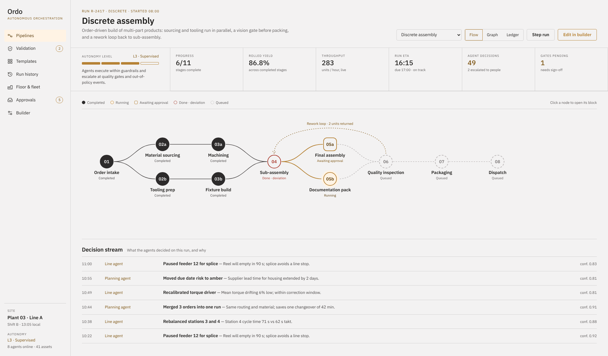
*Flow view: stages as nodes with branches, merges and a rework loop.*

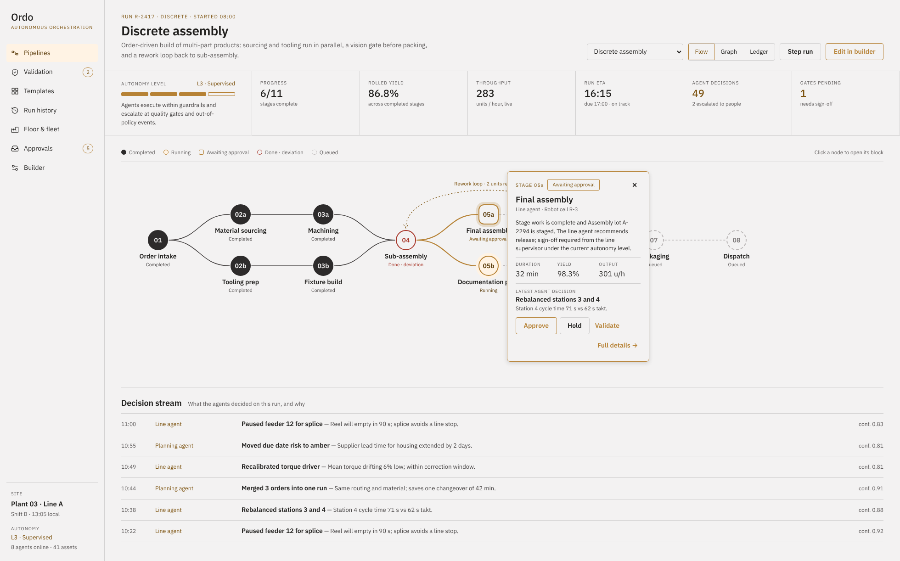
*Clicking a node opens its block: outcome, timing, yield, output, latest decision, and Approve / Hold / Validate on a gate.*

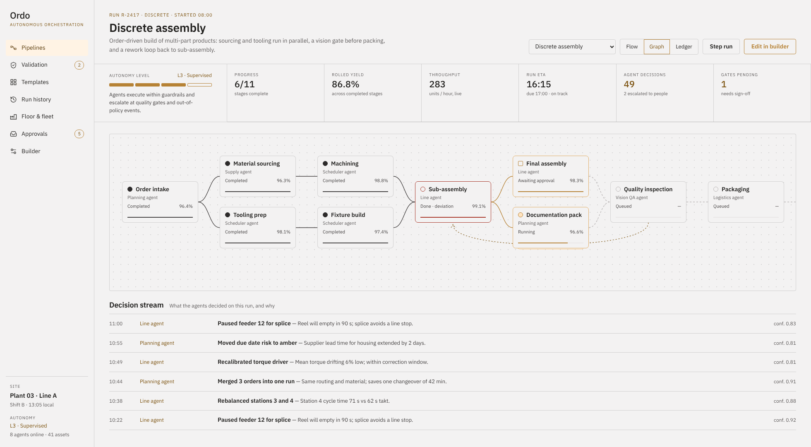

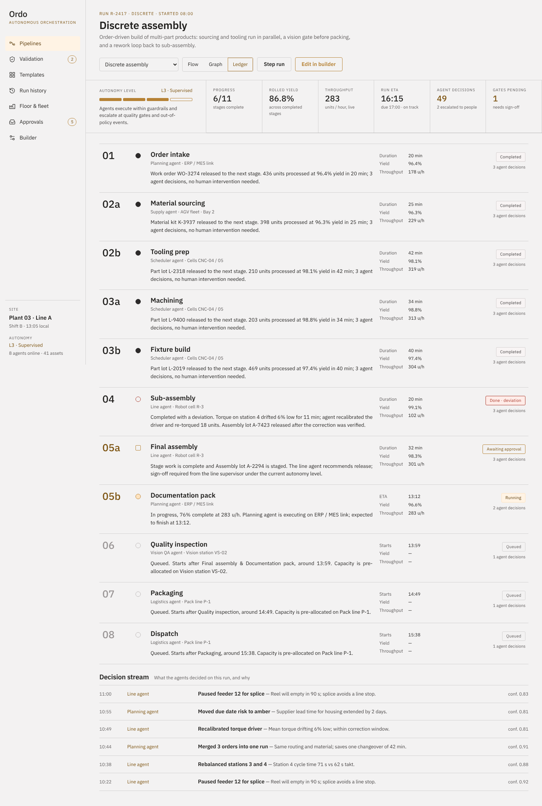

### Stage detail panel

**Full details** on a node block opens the side panel, which holds everything known about the stage:

- Status, agent and assigned resource
- Outcome summary
- Human approval gate with Approve, Hold and Validate with evidence
- Timing, yield, throughput, progress
- Quality metrics against targets (out-of-target values are marked ▲)
- Inputs and outputs (lot genealogy)
- Alerts and exceptions
- Decision log: time, action, reason, agent, confidence

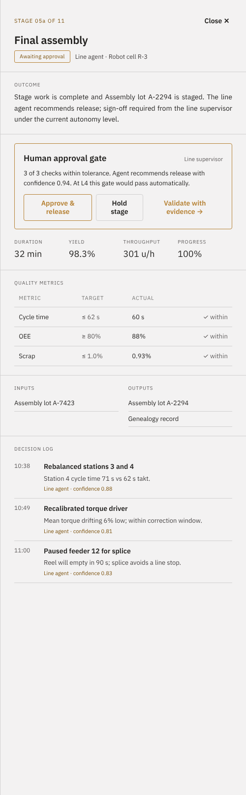

### Validation

The left list shows all validation packages with status, what each is waiting on, and progress through the six steps. Filters: All, Needs me, In review, Closed. **New from current pipeline** creates a package from the active gate or running stage.

The workspace has a step tracker (Draft → Agent pre-check → Submitted → QE review → Approval → Released), a readiness bar for the owner, and five numbered sections: Scope & acceptance, Validation checks, Proof & evidence, Sign-off, and Audit trail. **Acting as** switches the signed-in role for demonstration.

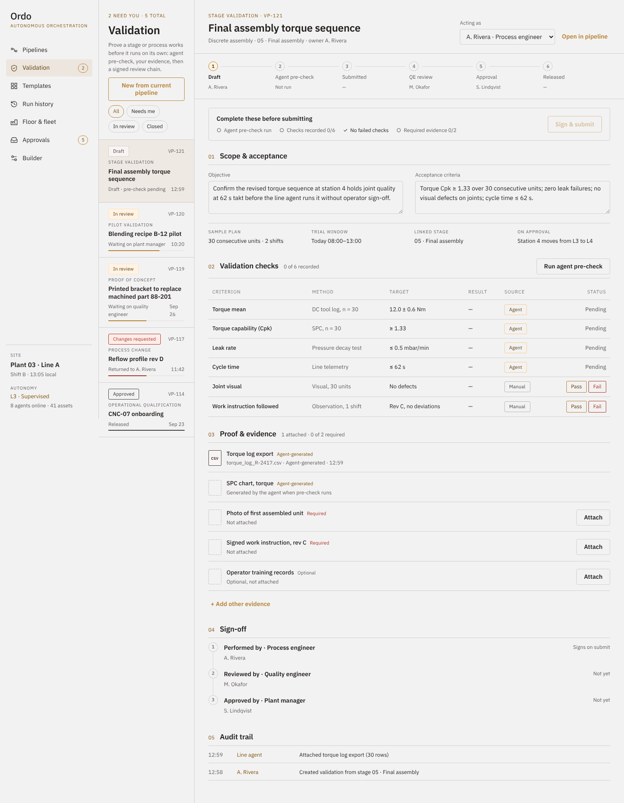
*Package in draft: pre-check pending, manual checks with Pass / Fail, required evidence slots to attach.*

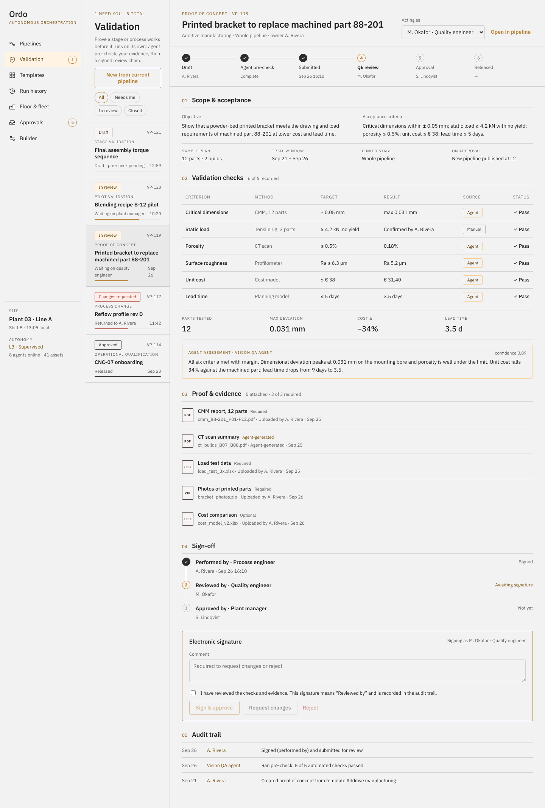
*Proof of concept in review: agent assessment, attached evidence, signature chain and the electronic signature form for the quality engineer.*

### Templates

The library of 15 pipeline templates, filterable by category. Each card lists its stage chain (parallel stages joined with "+"), stage and gate counts, and offers **Run pipeline** or **Customize** (opens the builder). All templates are listed in [pipeline-templates.md](pipeline-templates.md).

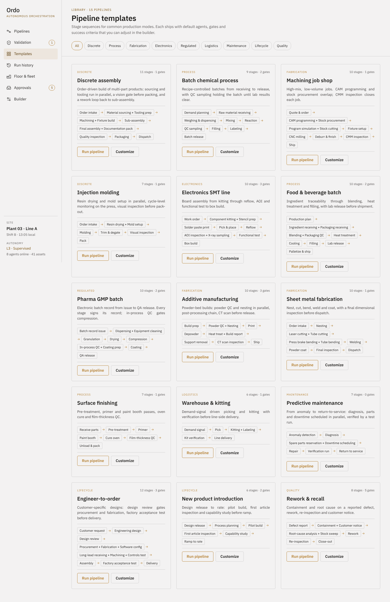

### Run history

Runs from the last seven days with start, duration, a per-stage outcome strip, yield, agent decisions, human interventions and outcome. Filter by outcome; click a row to open its pipeline.

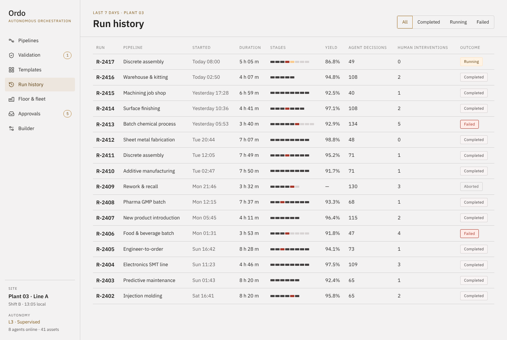

### Floor & fleet

- **Assets** groups every machine, robot, vehicle and station by zone with status, current job, utilization, OEE and owning agent.
- **Agents** shows each agent's scope, autonomy level, current task, decisions today, escalations and average confidence.

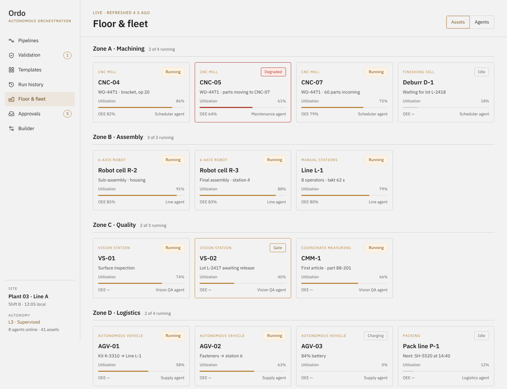

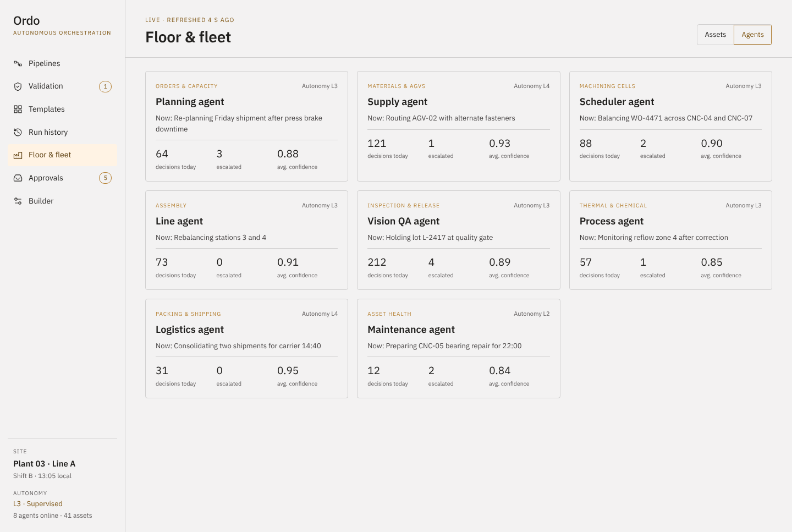

### Approvals & exceptions

The operational inbox for quick decisions raised by agents during a run: quality gates, supplier substitutions, capacity calls and equipment exceptions. Each item shows the agent's evidence, the options it considered with the recommended one marked, and its confidence. **Approve selected option**, **Reject & hold**, or open the stage in its pipeline. Decisions that need formal proof go to Validation instead.

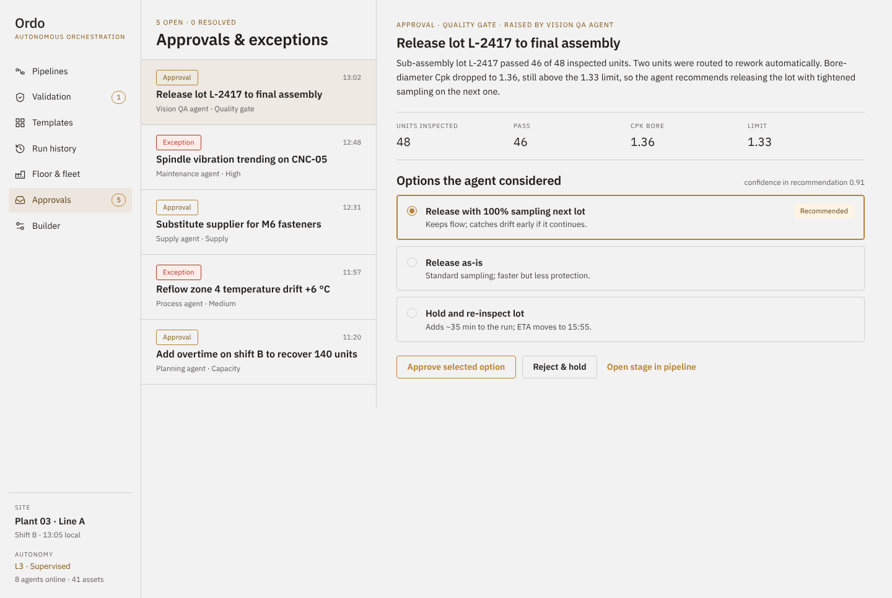

### Pipeline builder

Edit a template's stages: add from the palette, reorder, remove. For the selected stage set the name, assigned resource, execution mode (Auto, Approve, Manual), success criteria, timeout and escalation role. **Publish pipeline** creates a new template version.

| Mode | Behaviour |
| --- | --- |
| Auto | Agent runs the stage and advances on success criteria |
| Approve | Agent prepares and recommends; a person signs off before advancing |
| Manual | A person executes; the agent tracks and records |

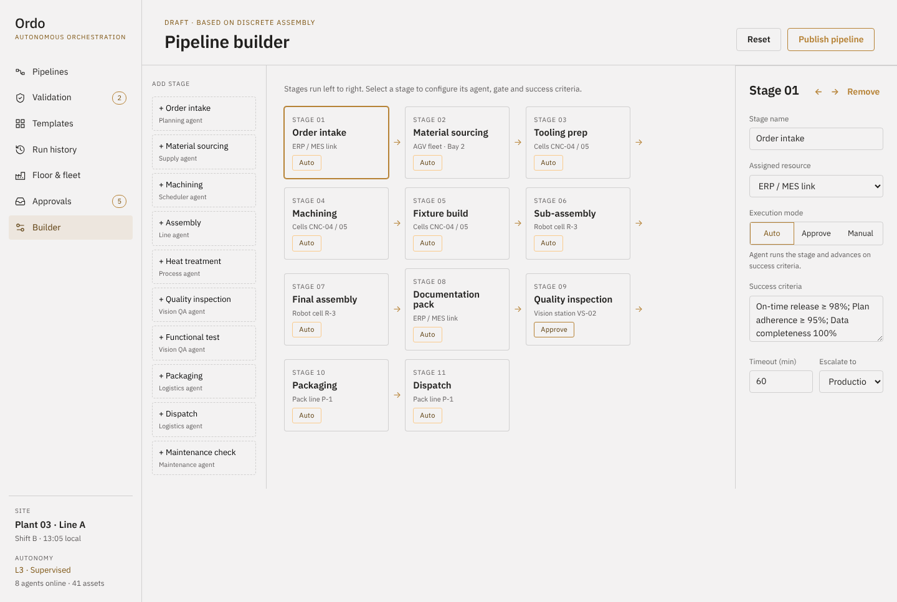

> **Prototype limits:** the builder shows stages as a single sequence (no editing of parallel branches or rework loops), and Publish does not yet create a template version. In a running pipeline the gate sits on the current stage rather than following the builder's Approve mode.
