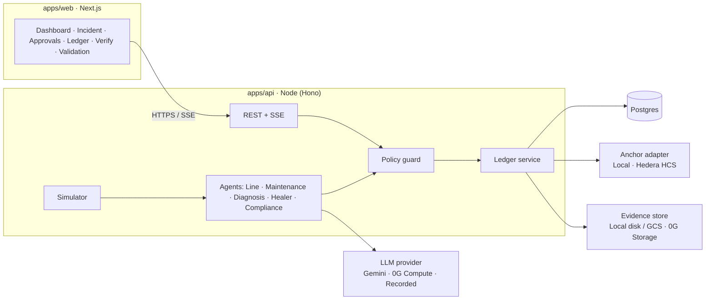

# Ordo — technical requirements (MVP build, Oct–Nov 2026)

**Status:** proposed · **Owner:** Srushti (backend) and Aloys (frontend) · **Supersedes** the stack sections of `PRD.md`, `PLAN.md` and `TASKS.md` (see §19).

This is the one document that says what we are building, with what, and how we know it works. Product intent stays in `PRD.md`; the long-term enterprise picture stays in `docs/architecture.md`. Where they disagree with this file, this file wins for the MVP. The review that led to these choices is in [improvements.md](improvements.md).

---

## 1. Goal and scope

### 1.1 What the MVP must do

One incident loop on one simulated line, end to end, live, in under 3 minutes:

1. A fault is injected (or emerges from replayed sensor data) on line `LINE-02`, machine `CNC-05`.
2. The **Line agent** detects the threshold breach or drift.
3. The **Maintenance agent** estimates failure probability and time-to-failure.
4. The **Diagnosis agent** (LLM) explains the likely root cause, citing the data.
5. The **Healer agent** (LLM tool calling) proposes one action from an allow-list.
6. The **policy guard** decides: allow, needs approval (which role), or block.
7. The operator approves, overrides or rejects, with a reason.
8. The action is applied to the simulated line; the dashboard shows recovery and downtime avoided.
9. Every step is written to a **hash-chained ledger**, verifiable on a Verify page, and a shift summary is generated.

### 1.2 Also in scope (in priority order, cut from the bottom)

- Validation package lite: one package type (stage validation), agent pre-check, three-signature chain.
- Multimodal triage: upload a photo, LLM flags a defect, gate goes to Held.
- Shift-handoff summary.
- Partner integrations for ETHGlobal (Hedera, 0G, ENS) behind adapters (§10).

### 1.3 Out of scope

Real PLC/OPC UA connectivity, edge clusters, Kafka, multi-plant, ERP/MES connectors, Planning / Supply / Logistics agents, the natural-language pipeline builder, real SSO. These stay in `architecture.md` as the target system.

---

## 2. Hard constraint: ETHGlobal eligibility

We are building before the event. ETHGlobal's rules say projects built before the event can still enter but **do not qualify for partner prizes or Finalist**, except on a partner's Continuity track. Our USD 5k target depends on partner prizes, so the code is structured to keep that door open:

- **Everything chain-related lives behind adapter interfaces** (§10). Before 5 Nov we ship only the local implementations (`LocalLedgerAnchor`, `GeminiLlm`, `PlainIdentity`). The Hedera, 0G and ENS adapters are **written at the event**, in a clearly separated package, and disclosed as the event's new work.
- Keep a `PRIOR_WORK.md` listing what existed before kickoff with the last pre-event commit hash, tagged `pre-ethglobal`.
- **Action this week:** ask ETHGlobal (Discord / support) in writing whether "pre-existing off-chain core + all partner integrations built at the event, disclosed" qualifies for Hedera, 0G and ENS prizes, and whether those partners run Continuity tracks in Mumbai. Adjust if they say no.

---

## 3. Architecture



- **One backend process** for the MVP. The simulator, agents, guard and ledger run in the API service and talk through an in-process typed event bus. No Pub/Sub, Dataflow or BigQuery.
- **Postgres is the system of record** for state; the ledger is a table with a hash chain; anchors and partner chains add external proof but are never required for the app to work.
- **Realtime to the browser over Server-Sent Events** (simpler than WebSockets, works on Cloud Run).
- **Every external dependency has a fake**: LLM → recorded responses; anchor → local; evidence store → disk. `DEMO_MODE=recorded` runs the full demo offline.

### 3.1 Stack

| Concern | Choice | Why |
| --- | --- | --- |
| Language | **TypeScript everywhere** (Node 22 LTS) | Hedera Agent Kit v4, 0G SDKs, viem/ENS and Next.js are all TS-first. One language, shared types, no generated client |
| Monorepo | pnpm workspaces + Turborepo | Fast installs, task caching, clear package boundaries |
| Web | Next.js 15 (App Router), React, Tailwind, TanStack Query | Matches PLAN.md frontend choice |
| API | Hono on Node | Small, fast, typed routes, OpenAPI via `@hono/zod-openapi` |
| Validation / contract | **zod schemas in `packages/contracts`** → OpenAPI generated from them | The contract is code; no hand-edited YAML, no blocked frontend |
| DB | Postgres 16 + Drizzle ORM + drizzle-kit migrations | Typed queries, SQL migrations in git. Neon (free tier) or Cloud SQL |
| LLM | `@google/genai` with a **current** Gemini Flash model pinned in config | Gemini 1.5 and 2.0 named in PRD are retired |
| Tests | Vitest (unit/integration), Playwright (e2e), Testcontainers or `pg-mem` for DB | |
| Lint/format | Biome (lint + format in one tool) | One config, fast |
| CI | GitHub Actions | §15 |
| Deploy | API → Cloud Run; Web → Vercel (or Cloud Run); DB → Neon | Cloud Run keeps the Google Cloud story available |

> If the team strongly prefers Python for the backend, the core (simulator, guard, ledger, LLM calls) works equally well in FastAPI. The cost is two languages and a generated client. The chain adapters would still be TypeScript.

---

## 4. Repository layout

```
ordo/
  apps/
    web/                 Next.js console                       owner: Aloys
    api/                 Hono service: routes, SSE, wiring     owner: Srushti
  packages/
    contracts/           zod schemas, event types, OpenAPI gen owner: Srushti (Aloys reviews every PR)
    domain/              pure logic: guard, forecast, ledger hashing, simulator. No I/O
    agents/              agent orchestration, prompts/, tools/
    adapters/            llm/, anchor/, storage/, identity/ — interfaces + local impls
    adapters-chain/      Hedera, 0G, ENS impls — EVENT WORK ONLY (§2)
    ui/                  shared React components + design tokens owner: Aloys
  policies/              policy files (YAML), versioned
  fixtures/              datasets, recorded LLM responses, scenario scripts
  e2e/                   Playwright demo test
  docs/ …                (existing)
```

Rule: `packages/domain` has no network, DB or clock access (time and randomness are injected). That makes the guard, forecast and ledger trivially testable.

---

## 5. Domain model

Adds `Incident`, `Approval`, `LedgerEntry.anchor` and chain references to `docs/data-model.md`.

| Entity | Key fields |
| --- | --- |
| `Line` | id, name, autonomyLevel (L1–L4), policyVersion |
| `Asset` | id, lineId, type, status (`running` / `degraded` / `down` / `maintenance`), ensName? |
| `TelemetrySample` | assetId, signal, value, unit, ts, quality (`good` / `uncertain` / `bad`) |
| `Batch` | id, lineId, assetId, units, stage, status, tokenRef? |
| `Incident` | id, assetId, openedAt, closedAt, severity, status (`open` / `awaiting_approval` / `mitigated` / `closed`), downtimeAvoidedMin |
| `Decision` | id, incidentId, agent, kind (`detect` / `forecast` / `diagnose` / `recommend` / `execute` / `summarize`), action (machine-readable), reason, confidence, alternatives[], modelId, promptHash, inputHash, outputHash, policyResult |
| `PolicyResult` | outcome (`allow` / `require_approval` / `block`), role?, ruleIds[], policyVersion |
| `Approval` | id, decisionId, requiredRole, status (`pending` / `approved` / `rejected` / `overridden`), actor, reason, ts, externalRef? |
| `Evidence` | id, incidentId?, packageId?, name, mime, sha256, uri, uploadedBy, ts |
| `LedgerEntry` | seq, ts, actor (agent id or user), type, payloadHash, prevHash, entryHash, anchor? { kind, ref, ts } |
| `ValidationPackage` / `Check` / `Signature` | as in `validation-workflow.md`, signatures always by a human role |

---

## 6. Simulator

- Deterministic: `seed` + `scenario` → identical telemetry every run, so the demo and tests are reproducible.
- Signals per asset: `vibration_rms` (mm/s), `bearing_temp` (°C), `spindle_load` (%), `cycle_time` (ms), `good_count`, `scrap_count`.
- Scenarios (YAML in `fixtures/scenarios/`): `bearing_wear` (slow vibration + temperature drift), `overheat` (step change), `vision_defect` (scrap spike), `sensor_fault` (quality = bad, must **not** trigger action).
- Optional replay of the **NASA IMS bearing dataset** (run-to-failure vibration) for the vibration signal, to make the forecast look honest.
- Tick: 1 s simulated = 1 min plant time by default; `speed` configurable.
- Endpoints: `POST /v1/sim/scenarios/{name}/start`, `POST /v1/sim/reset`.

---

## 7. Agents

Each agent is a function `(context) → Decision` with zod-validated input and output. LLM agents never act directly; they **propose**, the guard decides.

| Agent | Implementation | Output | Latency budget |
| --- | --- | --- | --- |
| **Line** (detect) | Rules: static limits per signal + rolling z-score / EWMA drift detector. Ignores samples with quality ≠ good | Anomaly with breached signal, value, limit, trend | < 100 ms |
| **Maintenance** (forecast) | Linear/exponential trend on vibration RMS and temperature → time to cross failure limit; logistic score → P(failure within 24 h / 5 d). Calibrated on the NASA IMS data offline, parameters stored in `fixtures/models/` with a version id | failureProbability, ttfHours, confidence, modelId | < 200 ms |
| **Diagnosis** (RCA) | LLM, structured output schema; input = anomaly, forecast, last 60 min aggregates, asset metadata. Must cite numbers present in the input | rootCause, evidence[], confidence | < 6 s |
| **Healer** (recommend) | LLM function calling over an **allow-listed tool set** (below). Exactly one primary action + up to 2 alternatives | action, args, reason, alternatives | < 6 s |
| **Compliance** (record/summarize) | Writes ledger entries for every step; LLM shift summary that must reference ledger seq numbers | summary, citedSeqs[] | < 8 s |

Healer tools (the only actions that can ever execute):

| Tool | Args | Effect in simulator |
| --- | --- | --- |
| `adjust_line_speed` | lineId, pctChange (−20…+10) | Changes cycle time and load |
| `hold_gate` | stageId, reason | Stage → Held |
| `reroute_batch` | batchId, targetAssetId, units | Moves remaining units |
| `open_work_order` | assetId, priority, window | Asset → maintenance at window |
| `request_inspection` | assetId, sampleRate | Raises scrap detection |

**LLM output that fails schema validation, cites numbers not in the input, or calls a tool outside the list is rejected** and recorded as a failed decision; the incident falls back to "needs human" (L1 behaviour).

---

## 8. Policy guard

One policy file per line, versioned in git (`policies/line-02.v1.yaml`). The guard is a pure function `evaluate(proposal, line, policy) → PolicyResult`.

Merged and de-duplicated from the PRD action matrix and `architecture.md` §10:

| Rule | L1 Assist | L2 Recommend | L3 Supervised | L4 Autonomous |
| --- | --- | --- | --- | --- |
| Any action (default) | require approval (operator executes) | require approval | allow if in guardrails | allow if in guardrails |
| `adjust_line_speed` −20…0 % | approval | approval | allow | allow |
| `adjust_line_speed` > 0 % | approval | approval | approval (plant manager) | approval (plant manager) |
| `hold_gate` single batch | approval | approval | allow | allow |
| `reroute_batch` ≤ 100 units | approval | approval | allow | allow |
| `reroute_batch` > 100 units | approval | approval | approval (plant manager) | allow |
| `open_work_order` | approval | approval | approval (maintenance lead) | allow |
| confidence < 0.70 | approval | approval | approval | approval |
| any input sample quality ≠ good | approval | approval | approval | approval |
| touches safety function / unknown tool | **block** | **block** | **block** | **block** |

Names are fixed as **L1 Assist, L2 Recommend, L3 Supervised, L4 Autonomous** (resolves the PRD vs architecture mismatch). Every result records `policyVersion` and the ids of the rules that fired. Tests: a parametrized matrix test covering every row × every level, plus property tests ("no block rule can be overridden by a higher level").

---

## 9. Ledger and verification

- **Canonical JSON** (RFC 8785 / JCS) for every payload; `payloadHash = sha256(canonical(payload))`.
- `entryHash = sha256(seq ‖ ts ‖ actor ‖ type ‖ payloadHash ‖ prevHash)`; genesis `prevHash = 0…0`.
- **Single writer**: appends go through one function holding a Postgres advisory lock, so two concurrent appends cannot fork the chain.
- Payloads stored in full in Postgres (and evidence files in the evidence store); the chain stores hashes.
- **Anchoring**: every N entries or every incident close, the latest `entryHash` is sent to the configured `AnchorAdapter`. Local adapter = signed checkpoint row (Ed25519 key from env). Hedera adapter = HCS message (event work).
- **Verify** (`GET /v1/verify/incidents/{id}`): recompute every payload hash and chain link for the incident's range, check the anchor, return per-step ✔/✘ with reasons. The UI exposes a "tamper" demo toggle in `DEMO_MODE` that alters one stored payload in a copy, to show ✘.

---

## 10. Adapter interfaces (partner integrations plug in here)

```ts
interface LlmProvider   { generateStructured<T>(req: LlmRequest, schema: ZodType<T>): Promise<LlmResult<T>> } // returns modelId, promptHash, outputHash, latency
interface AnchorAdapter { anchor(hash: string, meta: AnchorMeta): Promise<AnchorRef>; verify(ref: AnchorRef, hash: string): Promise<boolean> }
interface EvidenceStore { put(bytes: Uint8Array, mime: string): Promise<{ uri: string; sha256: string }>; get(uri: string): Promise<Uint8Array> }
interface ApprovalRail  { request(approval: Approval): Promise<ExternalRef | null>; confirm(ref: ExternalRef, signer: Actor): Promise<void> } // default: in-app only
interface PaymentRail   { pay(to: string, amount: Money, memo: string): Promise<ExternalRef> }   // default: no-op mock
interface IdentityResolver { nameFor(entity: AssetRef | AgentRef): Promise<string | null> }     // default: plain ids
```

| Interface | Now (pre-event) | At the event | Partner |
| --- | --- | --- | --- |
| `LlmProvider` | `GeminiLlm`, `RecordedLlm` | `ZeroGComputeLlm` (OpenAI-compatible endpoint via the 0G serving broker; testnet models such as Qwen 2.5 7B, GPT-OSS-20B, Gemma 3 27B) | 0G |
| `EvidenceStore` | `LocalDiskStore` / GCS | `ZeroGStorage` (`@0gfoundation/0g-ts-sdk`, Merkle root hash as id) | 0G |
| `AnchorAdapter` | `LocalSignedCheckpoint` | `HederaHcsAnchor` (`@hiero-ledger/sdk` ≥ 2.80; topic per line; mirror node `GET /api/v1/topics/{id}/messages` for verify) | Hedera |
| `ApprovalRail` | in-app | `HederaScheduledApproval` (`ScheduleCreateTransaction`, operator signs with `ScheduleSignTransaction`) | Hedera |
| `PaymentRail` | mock | Healer via **Hedera Agent Kit v4** (`@hashgraph/hedera-agent-kit` + `-ai-sdk`), HBAR/token transfer under a cap | Hedera |
| Batch tokens | DB rows | HTS NFT per batch (reroute = transfer, hold = freeze) | Hedera |
| `IdentityResolver` | plain ids | ENS names + text records via viem (Sepolia; ENSv2 deploys on L1, Namechain was cancelled) | ENS |

SDK names and versions above were checked on 19 Oct 2026 and are moving fast (Agent Kit v4 renamed its package; 0G docs show two compute SDK names). Re-check on the day.

---

## 11. API

REST under `/v1`, JSON, zod-validated, OpenAPI served at `/v1/openapi.json`.

| Method | Path | Purpose |
| --- | --- | --- |
| GET | `/health` | Liveness |
| GET | `/v1/lines/{id}` | Line, assets, autonomy, current KPIs |
| PATCH | `/v1/lines/{id}/autonomy` | Change level (plant manager role) |
| GET | `/v1/assets/{id}/telemetry?from&to&signals` | Series for charts (aggregated) |
| POST | `/v1/sim/scenarios/{name}/start` · `/v1/sim/reset` | Demo controls |
| GET | `/v1/incidents` · `/v1/incidents/{id}` | Incident with its decisions and approvals |
| POST | `/v1/approvals/{id}/approve` · `/reject` · `/override` | Body: reason (required for reject/override), alternative id for override |
| POST | `/v1/evidence` | Multipart upload; returns sha256 + uri |
| POST | `/v1/triage/image` | Multimodal defect check |
| GET | `/v1/ledger?from&to&incident` | Ledger entries |
| GET | `/v1/verify/incidents/{id}` | Verification report |
| POST | `/v1/summaries/shift` | Generate shift summary |
| GET | `/v1/stream` | SSE: `telemetry.tick`, `incident.opened`, `decision.recorded`, `approval.requested`, `approval.resolved`, `action.executed`, `ledger.appended`, `anchor.confirmed` |
| * | `/v1/validations/...` | As in `integrations-api.md`, stage validation only |

All mutating calls accept an `Idempotency-Key` header. Actions carry an id and expiry; the executor refuses duplicates and expired actions (from architecture.md §5, kept because it is cheap).

---

## 12. Frontend

Screens (rebuilt from `mockups/`, not from the prototype code):

1. **Line dashboard** — asset tiles with live signals and sparklines, autonomy badge, demo controls (mockups 10, 01).
2. **Incident** — timeline of the loop: anomaly → forecast → root cause → recommendation → guard verdict → approval → outcome (02, 05).
3. **Approvals** — pending items with reason, confidence, alternatives; approve / override / reject with required reason (12).
4. **Ledger** — entries with seq, time, actor, type, hashes, anchor status (04).
5. **Verify** — per-step ✔/✘ for an incident.
6. **Validation** (stretch) — package, checks, pre-check, signature chain (06, 07).

Requirements: SSE-driven updates with reconnect + backfill; role switcher ("acting as" Operator / QE / Plant manager) since there is no SSO; design tokens re-implemented from `_ds/styles.css` (IBM Plex Sans/Mono, palette); keyboard accessible, WCAG AA contrast; works at 1280 px and on a tablet.

---

## 13. Non-functional requirements

| Area | Requirement |
| --- | --- |
| Demo latency | Fault injection → recommendation visible ≤ 10 s with live LLM; ≤ 2 s in recorded mode |
| Reliability | Demo completes with network off (`DEMO_MODE=recorded`) |
| Determinism | Same seed + scenario → same detections and forecasts (LLM text may vary; recorded mode is exact) |
| Security | Secrets only in env / Secret Manager; no keys in the browser; chain keys server-side, one per demo role; rate limit LLM routes; uploaded files size-capped and type-checked; LLM prompts treat telemetry and uploaded content as data (prompt-injection guard, output schema enforcement) |
| Observability | Structured logs (pino) with request id and incident id; per-agent latency and failure counters; LLM token usage logged |
| Honesty | UI labels simulated data as simulated; README states what is real, simulated, mocked (PRD §Realism) |
| Cost | Free tiers only: Neon, Cloud Run, Gemini free tier / small paid quota, testnets |

---

## 14. "Downtime avoided" — defined, not invented

`downtimeAvoidedMin = expectedUnplannedDowntime − actualPlannedDowntime`, where expected = MTTR for an unplanned failure of that asset class (fixture value, e.g. 240 min) × P(failure before planned window), and actual = the planned maintenance window length if a work order was opened, else 0. Shown with its inputs on hover. No magic numbers on screen.

---

## 15. Testing and CI

| Layer | Tests | Gate |
| --- | --- | --- |
| `packages/domain` | Unit: detector, forecast, guard matrix (every rule × level), ledger hash/verify incl. tamper cases, simulator determinism | Required |
| `packages/agents` | Recorded-LLM tests: schema valid, cites only input numbers, tool in allow-list; invalid output → fallback | Required |
| `apps/api` | Route tests against Postgres (Testcontainers) incl. concurrent ledger appends | Required |
| Contract | OpenAPI generated from zod; web compiles against `packages/contracts` | Required (typecheck) |
| `e2e/demo.spec.ts` | Playwright runs the 9-step loop in recorded mode, asserts each UI state and a ✔ verify | **Required — acceptance test** |
| Live smoke | One real LLM call, one real anchor (when adapter exists), manual trigger | Nightly / manual |

GitHub Actions on every PR: install (pnpm, cached) → Biome → typecheck → unit → integration → e2e (recorded). Branch protection on `main`: CI green + one review.

---

## 16. Configuration

```
DATABASE_URL=
LLM_PROVIDER=gemini|recorded|0g
GEMINI_API_KEY=
GEMINI_MODEL=            # pin a current Flash model; check ai.google.dev deprecations
DEMO_MODE=live|recorded
SIM_SEED=42
ANCHOR=local|hedera
LEDGER_SIGNING_KEY=      # Ed25519, local anchor
EVIDENCE_STORE=local|gcs|0g
# event-only
HEDERA_NETWORK=testnet  HEDERA_OPERATOR_ID=  HEDERA_OPERATOR_KEY=  HEDERA_TOPIC_ID=
ZG_RPC_URL=  ZG_INDEXER_URL=  ZG_PRIVATE_KEY=
ENS_RPC_URL=  ENS_PARENT_NAME=  ENS_OWNER_KEY=
```

`.env.example` committed; real values in Secret Manager (Cloud Run) / Vercel env.

---

## 17. Deployment

- `apps/api` → container → Cloud Run in `asia-south1`, **min 1 / max 1 instance** (in-process simulator and single ledger writer), CPU always allocated, request timeout 3600 s for SSE. Full steps: [contracts-and-deployment.md](contracts-and-deployment.md).
- `apps/web` → Vercel, `NEXT_PUBLIC_API_URL` pointing at Cloud Run; CORS restricted to the web origin.
- Postgres → Neon (branch per PR optional). Migrations run on deploy.
- Seed script loads line, assets, policy, scenarios.

---

## 18. Milestones (today = Mon 19 Oct)

| Dates | Milestone | Srushti | Aloys | Exit test |
| --- | --- | --- | --- | --- |
| 19–21 Oct | **M0 Foundations** | Monorepo, CI, Postgres + Drizzle, `contracts` package, `/health` on Cloud Run | Next.js shell, tokens, nav, Vercel deploy, Playwright smoke | CI green on `main`; both URLs live |
| 22–25 Oct | **M1 Line + guard + ledger** | Simulator + scenarios, detector, forecast, policy guard + matrix test, ledger + verify | Dashboard with live SSE, demo controls, Ledger screen | Fault → anomaly appears in UI and ledger; guard matrix test green |
| 26–29 Oct | **M2 AI loop** | LLM provider + recorded mode, Diagnosis + Healer agents with tool allow-list, action executor | Incident timeline, Approvals with approve/override/reject | `e2e/demo.spec.ts` passes in recorded mode |
| 30 Oct–1 Nov | **M3 Proof + polish** | Signed checkpoints, verify endpoint, shift summary, downtime-avoided calc | Verify screen with tamper demo, shift summary view, empty/error states | Full loop live on deployed URLs ≤ 3 min |
| 2–4 Nov | **M4 Freeze** | Stretch: validation lite or image triage; adapter interfaces stable; tag `pre-ethglobal`, write `PRIOR_WORK.md` | Demo script rehearsal, video draft | Rehearsed 3×, recorded mode tested offline |
| 5–7 Nov | **ETHGlobal** | Hedera adapters (HCS anchor, scheduled approval, Agent Kit payment, HTS batches) | 0G compute/storage adapters, ENS names in UI, submission | Partner qualification lines met, disclosed |

---

## 19. What this changes in existing docs

- `PRD.md`: stack sections (Cloud Run + Pub/Sub + Dataflow + BigQuery + Firestore + Vertex, Gemini 1.5/2.0) are superseded by §3. Product sections stand.
- `PLAN.md` / `TASKS.md`: ownership idea and Definition of Done stand; Phase 0–3 tasks are replaced by §18. The OpenAPI-YAML-first contract is replaced by zod-first (§3.1), which removes the "Aloys blocked until mock server" dependency.
- `docs/architecture.md`: unchanged as the long-term target; §17 "not a running system" becomes true only for the parts listed in §1.3.

## 20. Open decisions

1. TypeScript backend (recommended) vs FastAPI — decide by **21 Oct**.
2. ETHGlobal eligibility answer from organisers (§2) — chase by **24 Oct**.
3. Are we still submitting to the Google Cloud AI Builder Cup? If yes, its deadline and required Google services must be added to §18.
4. Confidence threshold (0.70 proposed) and reroute unit limit (100 proposed).
