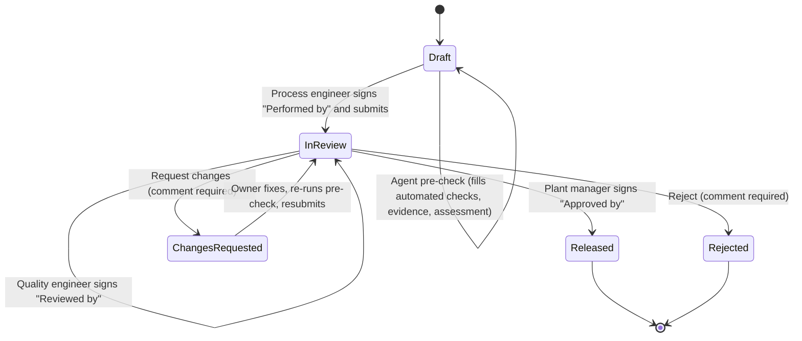

# Validation & sign-off workflow

A validation package is the formal record that a stage, process change, pilot, machine qualification or proof of concept meets its acceptance criteria. It holds scope, checks, evidence, an ordered signature chain and an audit trail.

## Package types

| Type | Used to prove | Typical outcome on approval |
| --- | --- | --- |
| Stage validation | A stage on a specific run meets its criteria | Gate released; stage may move up an autonomy level |
| Process change | A changed parameter, recipe or profile is safe | Change becomes the line default |
| Pilot validation | A new recipe or method works across pilot batches | Added to approved list |
| Proof of concept | A new pipeline or part replacement is viable | New pipeline published at L2 |
| Operational qualification | A new or repaired asset performs like existing ones | Asset joins the agent pool |

## Steps

1. **Draft.** The process engineer defines objective, acceptance criteria, sample plan and trial window. Checks are seeded from the stage's success criteria.
2. **Agent pre-check.** The owning agent fills in every automated check from run data by comparing each measured value with its target, attaches generated evidence (the run record, and a parameter chart that draws each parameter against its band with the signal's trend over the stage), and writes an assessment with key figures and confidence.
3. **Submit.** The engineer records manual checks (Pass / Fail), attaches required evidence and signs as **Performed by**.
4. **QE review.** The quality engineer signs as **Reviewed by**, or requests changes / rejects with a mandatory comment.
5. **Approval.** The plant manager signs as **Approved by**.
6. **Released.** The outcome is applied (gate released, autonomy promoted, change made default) and recorded in the ledger.

## Signature chain

| Order | Role | Meaning | Person (prototype) |
| --- | --- | --- | --- |
| 1 | Process engineer | Performed by | A. Rivera |
| 2 | Quality engineer | Reviewed by | M. Okafor |
| 3 | Plant manager | Approved by | S. Lindqvist |

## Rules

- **Sign & submit** is enabled only when the pre-check has run, every check is recorded, no check has failed and all required evidence is attached.
- Only the role at the current step may sign. Each signature states its meaning and requires the signer to confirm they reviewed the checks and evidence.
- Request changes and Reject require a comment. A returned package goes back to its owner; all later signatures are cleared on resubmit.
- Re-running the pre-check after changes refreshes automated results and the assessment.
- Files are hashed on upload. A changed file is a new version; earlier versions stay in the record.
- Every action (create, attach, remove, check, sign, return, release) writes an audit entry.

## Readiness checklist (what blocks "Sign & submit")

| Check | Passes when | Shown as |
| --- | --- | --- |
| Agent pre-check run | The owning agent has filled the automated checks | ✓ Agent pre-check run |
| Checks recorded | Every check has a result (automated or manual) | Checks recorded 5/5 |
| No failed checks | No check is marked Fail | ▲ 1 failed check, if any |
| Required evidence | Every evidence slot marked *Required* has a file | Required evidence 2/2 |

Agent-generated evidence (the run record, the parameter chart) is attached automatically when the pre-check runs. Optional evidence never blocks submission.

## Who sees what

| Role | Sees the package as | Can do |
| --- | --- | --- |
| Process engineer (owner) | Editable while Draft or Changes requested | Edit objective and acceptance, run pre-check, record manual checks, attach/remove evidence, sign and submit |
| Quality engineer | Locked, "Awaiting signature" when it is their step | Sign "Reviewed by", request changes, reject |
| Plant manager | Locked, "Awaiting signature" when it is their step | Sign "Approved by", request changes, reject |
| Anyone else | Read-only, with a note saying who it is waiting on | — |

The **Needs me** filter shows packages where the current user is the owner of a draft or returned package, or holds the role at the current signature step.

## Worked example: a returned process change

Package **VP-117 · Reflow profile rev D** (Process change, Electronics SMT line, stage 05 · Reflow) in the prototype:

1. **Objective:** lower peak reflow temperature by 4 °C to reduce stress on a new BGA package.
2. **Acceptance:** BGA void rate ≤ 25% (X-ray); AOI first-pass ≥ 99%; no tombstoning; peak 238–245 °C.
3. **Pre-check:** the Process agent records peak 241 °C ✓, time above liquidus 74 s ✓, AOI first-pass 99.4% ✓, but **void rate 27% ✗** (2 of 5 boards above the limit). Confidence 0.74.
4. The process engineer signs **Performed by** and submits.
5. The quality engineer **requests changes**: "Void rate is above the limit on 2 of 5 boards. Extend soak by 10 s and re-run X-ray." The package returns to its owner; the QE's step shows *Returned*.
6. The engineer extends soak by 10 s and **re-runs the pre-check**. The void rate is now 21% ✓; the assessment and confidence (0.87) update.
7. The engineer **resubmits**. All later signatures are cleared, and the chain starts again at QE review.
8. QE and plant manager sign. On release, **profile rev D becomes the line default**, and every step above is in the audit trail.

## Outcomes applied on release

| Package type | What changes in the system |
| --- | --- |
| Stage validation | The linked gate is released and the stage completes; the stage may be promoted one autonomy level |
| Process change | The new parameter, recipe or profile becomes the line default |
| Pilot validation | The recipe or method is added to the approved list |
| Proof of concept | The new pipeline is published as a template at L2 |
| Operational qualification | The asset joins the owning agent's pool (e.g. CNC-07 joins the Scheduler agent pool) |
